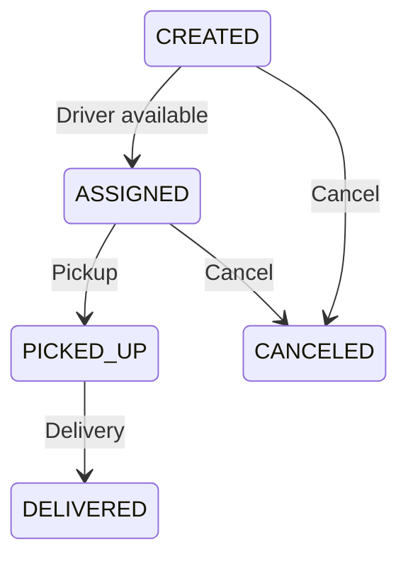

# Design Peer to Peer Parcel Delivery System in Python

#### Problem Statement

[https://codezym.com/question/76-design-peer-to-peer-parcel-delivery](https://codezym.com/question/76-design-peer-to-peer-parcel-delivery)

Keep two things in order: waiting parcels and free drivers. A queue gives us the oldest waiting order, and a min-heap gives us the smallest free driver ID. Maps make status lookups quick. A few state checks handle pickup, cancellation, and delivery, so a separate design pattern is unnecessary for these fixed rules.


## What the system needs to remember

An assigned driver becomes busy immediately, even before pickup. The driver becomes free after delivery or cancellation before pickup.

Orders follow these transitions.



`ACCEPTED` and `PENDING` are responses from `createOrder`, not stored order states.

| Creation result | Returned value | Stored order state |
| --- | --- | --- |
| A driver is assigned | `ACCEPTED` | `ASSIGNED` |
| All drivers are busy | `PENDING` | `CREATED` |
| The request is invalid | `INVALID` | No new order |

The statement leaves duplicate order IDs and unknown status lookups unspecified. This solution rejects reused order IDs or `None` with `INVALID` and returns `ERROR` for unknown order or driver status lookups. Reuse is rejected even after cancellation or delivery.


## 1. Start with a simple scan

Keep orders in creation order. Whenever assignment is needed, scan for the first `CREATED` order, then scan all drivers to find the smallest available ID.

For example, a dictionary can store each driver's current order. `None` means available.

```python
def findAvailableDriver(self):
    best = None
    for driverId, orderId in self.driverOrders.items():
        if orderId is None and (best is None or driverId < best):
            best = driverId
    return best
```

This works, but one assignment can scan all orders and drivers, costing `O(N + D)` for `N` stored orders and `D` drivers. Repeating these scans does unnecessary work.


## 2. Use a queue and a min-heap

| Data | Structure | Why we need it |
| --- | --- | --- |
| `Order` | Small dataclass | Groups the parcel details, status, and assigned driver |
| `customers`, `deliverableItems` | Sets | Check exact customer and item IDs quickly |
| `orders` | ID to `Order` dictionary | Find an order without scanning |
| `driverOrders` | Driver ID to order ID dictionary | Track busy drivers and recognize valid driver IDs |
| `pendingOrders` | `deque` queue | Preserve creation order |
| `availableDrivers` | list managed by `heapq` | Choose the smallest free driver ID |

`heapq` keeps the smallest string at the front of a list. `heappop()` removes it and `heappush()` adds a driver back. `deque.popleft()` removes the oldest waiting order.

Compare complete driver IDs as strings. With twelve drivers, the order begins `dv-0`, `dv-1`, `dv-10`, `dv-11`, `dv-2`. Comparing only the number would select the wrong driver.

The State pattern could give every status its own class, but these transitions need only short checks. Strategy would help if driver selection rules were interchangeable. Here, the rule is fixed, so neither adds useful simplicity.


## 3. Keep assignment in one helper

`assignPendingOrders` repeatedly takes the oldest waiting order and the smallest free driver. It records the assignment in both the order and `driverOrders`.

Call it after creating an order and whenever a driver is released. This makes automatic assignment happen before the public method returns.

Canceling a waiting order only changes its status. Its queue entry stays until the helper reaches it, then the helper skips it. Each entry is removed once, so cancellation does not need a search through the queue.

Canceling an assigned order changes its status first, then releases its driver. Delivery follows the same release path. Pickup and delivery check both the current status and the assigned driver. Failed requests leave the system unchanged.

An order keeps its last assigned driver ID after cancellation or delivery. The status prevents any further action on that order. `driverOrders` records the driver's current job.


## Walk through a busy driver

Assume one driver, `dv-0`, and a valid customer and item.

| Action | Return | What changes |
| --- | --- | --- |
| Create `A` | `ACCEPTED` | `dv-0` is assigned to `A` |
| Create `B` | `PENDING` | `B` waits |
| Create `C` | `PENDING` | `C` waits after `B` |
| Cancel `B` | `CANCELED` | Its queue entry remains |
| Cancel `A` | `CANCELED` | The helper skips `B` and assigns `C` to `dv-0` |
| Pick up `C` with `dv-0` | `PICKED_UP` | `C` can no longer be canceled |
| Cancel `C` | `ERROR` | Nothing changes |
| Deliver `C` with `dv-0` | `DELIVERED` | `dv-0` becomes available |


## Why this works

The queue preserves creation order, and skipped canceled entries cannot change the order of the remaining parcels. The heap contains each free driver exactly once, so every assignment selects the correct driver and removes that driver from availability.

Only valid transitions release a driver. Repeated cancellation or delivery fails before another release. After assignment finishes, a free driver and a waiting non-canceled order cannot remain together.


## Complexity

Let `U` be the number of customers, `I` the number of configured items, `D` the number of drivers, and `N` the number of valid orders created. These costs assume bounded ID lengths and average constant-time hash lookups.

| Operation | Time |
| --- | --- |
| Initialization, including heap construction | `O(U + I + D)` |
| Pickup and status lookup | `O(1)` |
| Cancel a waiting order | `O(1)` |
| Create, deliver, or cancel an assigned order | `O(log(D + 1))` amortized |

One call can additionally skip `K` canceled queue entries, taking `O(K + log(D + 1))`. Each entry is skipped only once, so that extra work totals `O(N)` across the system's lifetime.

Space is `O(U + I + D + N)`. Old orders remain stored so their status can still be queried.


## Complete Python code

The public method names match the supplied starter code. `Order` is a dataclass because it only holds one order's data.

```python
from collections import deque
from dataclasses import dataclass
import heapq
from typing import Optional


@dataclass
class Order:
    orderId: str
    customerId: str
    itemId: str
    status: str = "CREATED"
    driverId: Optional[str] = None


class PeerToPeerDeliverySystem:
    def __init__(self, totalUsers, totalDrivers, deliverableItemIds):
        self.customers = {f"user-{i}" for i in range(totalUsers)}
        self.deliverableItems = set(deliverableItemIds)
        self.orders = {}

        # A None value means the driver is available.
        self.driverOrders = {f"dv-{i}": None for i in range(totalDrivers)}
        self.pendingOrders = deque()

        # String ordering puts dv-10 before dv-2.
        self.availableDrivers = list(self.driverOrders)
        heapq.heapify(self.availableDrivers)

    def createOrder(self, orderId, customerId, itemId):
        if (orderId is None or orderId in self.orders
                or customerId not in self.customers
                or itemId not in self.deliverableItems):
            return "INVALID"

        order = Order(orderId, customerId, itemId)
        self.orders[orderId] = order
        self.pendingOrders.append(orderId)
        self.assignPendingOrders()

        return "ACCEPTED" if order.status == "ASSIGNED" else "PENDING"

    def cancelOrder(self, orderId):
        order = self.orders.get(orderId)
        if order is None or order.status not in ("CREATED", "ASSIGNED"):
            return "ERROR"

        # Mark it first so assignment can never reuse a canceled order.
        order.status = "CANCELED"
        if order.driverId is not None:
            self.releaseDriver(order.driverId)

        return "CANCELED"

    def pickUpOrder(self, driverId, orderId):
        order = self.orders.get(orderId)
        if (order is None or driverId not in self.driverOrders
                or order.status != "ASSIGNED"
                or driverId != order.driverId):
            return "ERROR"

        order.status = "PICKED_UP"
        return "PICKED_UP"

    def deliverOrder(self, driverId, orderId):
        order = self.orders.get(orderId)
        if (order is None or driverId not in self.driverOrders
                or order.status != "PICKED_UP"
                or driverId != order.driverId):
            return "ERROR"

        order.status = "DELIVERED"
        self.releaseDriver(driverId)
        return "DELIVERED"

    def getOrderStatus(self, orderId):
        order = self.orders.get(orderId)
        return "ERROR" if order is None else order.status

    def getDriverStatus(self, driverId):
        if driverId not in self.driverOrders:
            return "ERROR"

        orderId = self.driverOrders[driverId]
        return "AVAILABLE" if orderId is None else f"BUSY:{orderId}"

    def assignPendingOrders(self):
        while self.pendingOrders and self.availableDrivers:
            order = self.orders[self.pendingOrders.popleft()]

            # Canceled waiting orders stay in the queue until reached.
            if order.status != "CREATED":
                continue

            driverId = heapq.heappop(self.availableDrivers)
            order.driverId = driverId
            order.status = "ASSIGNED"
            self.driverOrders[driverId] = order.orderId

    def releaseDriver(self, driverId):
        self.driverOrders[driverId] = None
        heapq.heappush(self.availableDrivers, driverId)
        self.assignPendingOrders()
```
