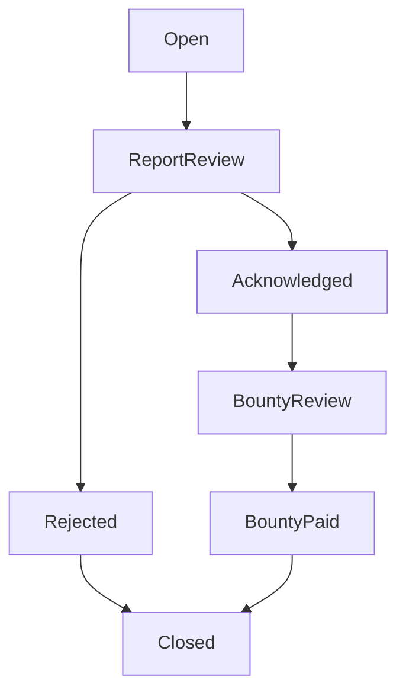

# Design a Bug Bounty Program Management System in Java

#### Problem Statement

[https://codezym.com/question/79-design-bug-bounty-program](https://codezym.com/question/79-design-bug-bounty-program)

Keep employees and bug reports in maps, and validate every update before changing a report. A map of allowed next statuses handles the workflow. We do not need the State pattern here, because statuses only restrict the next move and do not have separate behavior.


## Start with a list

We could store reports in a list and search by title whenever someone edits or deletes a report.

```java
BugReport findReport(List<BugReport> reports, String title) {
    for (BugReport report : reports) {
        if (report.title.equals(title)) {
            return report;
        }
    }
    return null;
}
```

With many reports, repeating this search becomes wasteful. Since each title is unique, a map from title to report gives us average constant-time lookup. Listing reports still needs a scan.


## Keep the design small

`BugBountyProgram` implements the required methods. It uses these objects and collections.

| Object or collection | Why we need it |
| --- | --- |
| `User` and the users map | Store each employee's name, email, and role. Look up employees by name. |
| `BugReport` and the reports map | Keep report fields together. Find, update, or delete a report by its title. |
| A map of status names to sets | Check whether a requested next status is allowed. |
| A comment list inside each report | Append internal comments without replacing earlier comments. |

Use a `HashMap` for users and a `LinkedHashMap` for reports. The latter keeps insertion order while retaining average constant-time lookup and removal.

A separate reporter class is unnecessary because the API only stores the reporter's email.


## Keep workflow rules in one place



The transition map contains exactly these arrows. `Closed` has no next status. Requesting the current status again is also invalid.

Only `Closed` counts as completed. Both `Rejected` and `BountyPaid` remain incomplete until they move to `Closed`.


## Validate first, then apply the update

For `updateBugReport`, check these rules in order.

1. The caller must be a preloaded user.
2. The report must exist.
3. Any requested assignee must be a preloaded user.
4. If status is included, the caller must be the current assignee.
5. The requested status transition must be allowed.

Only after these checks pass do we change fields and append comments. For example, a request containing a bounty change and an invalid status change leaves both the bounty and status unchanged.

Any employee can edit ordinary fields, add comments, or assign a report. Admin status does not bypass the assignee check for status changes.


## Handle the remaining API details

- **Create:** Check the caller, duplicate title, and required fields. Set status to `Open`, bounty to `0`, and assignee to an empty string. Record the creation timestamp.
- **Delete:** Check the caller and report, then require the `admin` role. Remove the report from the map.
- **List:** Scan reports and apply the requested ownership and completion filters. An unknown caller gets an empty list.
- **Close:** Record the closing timestamp only when a valid transition reaches `Closed`.

The list result uses the six fields shown in the problem's examples, in the same order. Description, comments, and timestamps stay inside the report. No reporter-facing method is added.

Split each `key=value` string only at the first `=` so values such as `description=a=b` remain intact. Bounty amounts stay as text because this API only stores and displays them. Severity and bounty values follow the stated input constraints.


## Choices where the statement is silent

The statement does not define report ordering or how assignment and status interact within one request. This solution uses creation order and checks status permission against the assignee at the start of the call. Assigning a new report and then changing its status therefore takes two calls.

It also gives no separate error for an empty title or reporter email. This implementation returns `ERROR_MISSING_REQUIRED_FIELDS` for either case. An empty description is allowed as long as its key is present.


## Complexity

Let `B` be the number of reports, `U` the number of users, and `K` the number of entries in a create or update request. These bounds treat individual strings as fixed-size values and use average hash-map costs.

| Operation | Time |
| --- | --- |
| Initialize users | `O(U)` |
| Create or update a report | `O(K)` |
| Delete a report | `O(1)` |
| List reports | `O(B)` |

Stored data takes `O(U + B + C)` space, where `C` is the total number of comments. Parsing needs `O(K)` temporary space, and listing needs up to `O(B)` result space. Including string lengths, also count the text stored, parsed, and returned.


## Java implementation

Use `BugBountyProgram.java` as the filename. The helper classes are top-level classes, and the public method signatures match the starter code.

```java
import java.util.*;

class User {
    String name;
    String email;
    String role;

    User(String name, String email, String role) {
        this.name = name;
        this.email = email;
        this.role = role;
    }
}

class BugReport {
    String title;
    String description;
    String severity;
    String reporterEmail;
    String status = "Open";
    String bountyAmount = "0";
    String assignedUser = "";
    String createdTimeStamp;
    String closedTimeStamp = "";
    List<String> comments = new ArrayList<>();

    BugReport(String title, String description, String severity, String reporterEmail) {
        this.title = title;
        this.description = description;
        this.severity = severity;
        this.reporterEmail = reporterEmail;
        createdTimeStamp = String.valueOf(System.currentTimeMillis());
    }

    String toSummary() {
        // Keep the field order shown in the problem's list examples.
        return "title=" + title
                + ",status=" + status
                + ",severity=" + severity
                + ",bountyAmount=" + bountyAmount
                + ",reporterEmail=" + reporterEmail
                + ",assignedUser=" + assignedUser;
    }
}

public class BugBountyProgram {
    Map<String, User> users = new HashMap<>();
    Map<String, BugReport> reports = new LinkedHashMap<>();
    Map<String, Set<String>> allowedTransitions = new HashMap<>();

    public BugBountyProgram(List<String> preloadedUsers) {
        for (String entry : preloadedUsers) {
            Map<String, String> fields = parseFields(Arrays.asList(entry.split(",")));
            User user = new User(fields.get("name"), fields.get("email"), fields.get("role"));
            users.put(user.name, user);
        }

        allowedTransitions.put("Open", new HashSet<>(Arrays.asList("ReportReview")));
        allowedTransitions.put("ReportReview", new HashSet<>(Arrays.asList("Rejected", "Acknowledged")));
        allowedTransitions.put("Rejected", new HashSet<>(Arrays.asList("Closed")));
        allowedTransitions.put("Acknowledged", new HashSet<>(Arrays.asList("BountyReview")));
        allowedTransitions.put("BountyReview", new HashSet<>(Arrays.asList("BountyPaid")));
        allowedTransitions.put("BountyPaid", new HashSet<>(Arrays.asList("Closed")));
        allowedTransitions.put("Closed", new HashSet<>());
    }

    Map<String, String> parseFields(List<String> entries) {
        Map<String, String> values = new HashMap<>();
        for (String entry : entries) {
            // Split once so a value can contain another '='.
            String[] parts = entry.split("=", 2);
            if (parts.length == 2) {
                values.put(parts[0], parts[1]);
            }
        }
        return values;
    }

    public String createBugReport(String title, String createdByUser, List<String> fields) {
        if (!users.containsKey(createdByUser)) {
            return "ERROR_INVALID_USER";
        }
        if (reports.containsKey(title)) {
            return "ERROR_DUPLICATE_TITLE";
        }

        Map<String, String> values = parseFields(fields);
        if (title.isEmpty()
                || !values.containsKey("description")
                || !values.containsKey("severity")
                || !values.containsKey("reporterEmail")
                || values.get("reporterEmail").isEmpty()) {
            return "ERROR_MISSING_REQUIRED_FIELDS";
        }

        BugReport report = new BugReport(
                title, values.get("description"), values.get("severity"), values.get("reporterEmail"));
        reports.put(title, report);
        return "OK";
    }

    public String updateBugReport(String title, String updatedByUser, List<String> updates) {
        if (!users.containsKey(updatedByUser)) {
            return "ERROR_INVALID_USER";
        }
        BugReport report = reports.get(title);
        if (report == null) {
            return "ERROR_NOT_FOUND";
        }

        Map<String, String> values = parseFields(updates);
        if (values.containsKey("assignedUser")
                && !users.containsKey(values.get("assignedUser"))) {
            return "ERROR_INVALID_USER_FOR_ASSIGNMENT";
        }

        if (values.containsKey("status")) {
            // Check ownership before applying any assignment in this request.
            if (!report.assignedUser.equals(updatedByUser)) {
                return "ERROR_FORBIDDEN";
            }
            if (!allowedTransitions.get(report.status).contains(values.get("status"))) {
                return "ERROR_INVALID_TRANSITION";
            }
        }

        // Validate first. A rejected request must not partially edit the report.
        if (values.containsKey("description")) {
            report.description = values.get("description");
        }
        if (values.containsKey("severity")) {
            report.severity = values.get("severity");
        }
        if (values.containsKey("bountyAmount")) {
            report.bountyAmount = values.get("bountyAmount");
        }
        if (values.containsKey("assignedUser")) {
            report.assignedUser = values.get("assignedUser");
        }
        if (values.containsKey("status")) {
            report.status = values.get("status");
            if (report.status.equals("Closed")) {
                report.closedTimeStamp = String.valueOf(System.currentTimeMillis());
            }
        }

        // Preserve every comment, including multiple comments in one request.
        for (String entry : updates) {
            if (entry.startsWith("comment=")) {
                report.comments.add(entry.substring("comment=".length()));
            }
        }
        return "OK";
    }

    public String deleteBugReport(String title, String deletedByUser) {
        User user = users.get(deletedByUser);
        if (user == null) {
            return "ERROR_INVALID_USER";
        }
        if (!reports.containsKey(title)) {
            return "ERROR_NOT_FOUND";
        }
        if (!user.role.equals("admin")) {
            return "ERROR_FORBIDDEN";
        }

        reports.remove(title);
        return "OK";
    }

    public List<String> listBugReports(String viewType, String requestedByUser) {
        List<String> result = new ArrayList<>();
        if (!users.containsKey(requestedByUser)) {
            return result;
        }

        for (BugReport report : reports.values()) {
            boolean assignedToMe = report.assignedUser.equals(requestedByUser);
            boolean completed = report.status.equals("Closed");
            boolean include = false;

            switch (viewType) {
                case "all":
                    include = true;
                    break;
                case "assignedToMe":
                    include = assignedToMe;
                    break;
                case "assignedToMe:completed":
                    include = assignedToMe && completed;
                    break;
                case "assignedToMe:incomplete":
                    include = assignedToMe && !completed;
                    break;
            }

            if (include) {
                result.add(report.toSummary());
            }
        }
        return result;
    }
}
```
