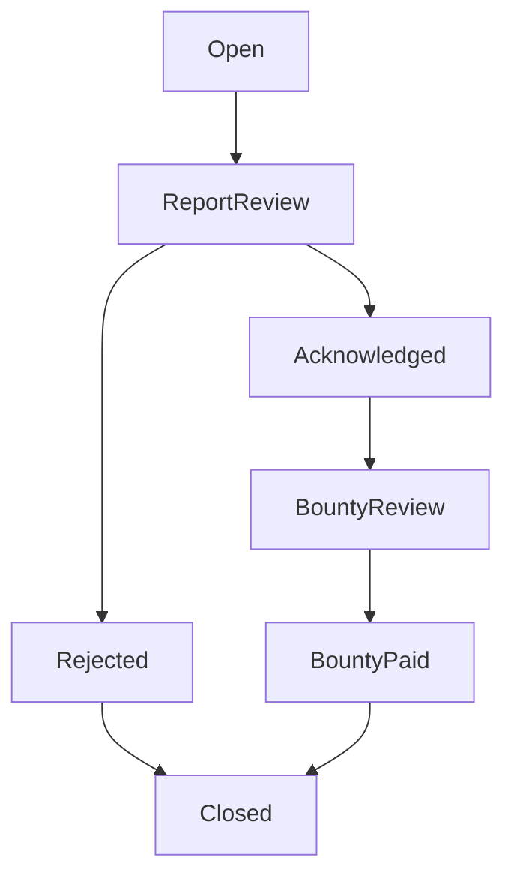

# Design a Bug Bounty Program Management System in Python

#### Problem Statement

[https://codezym.com/question/79-design-bug-bounty-program](https://codezym.com/question/79-design-bug-bounty-program)

Keep employees and bug reports in maps, and validate every update before changing a report. A map of allowed next statuses handles the workflow. We do not need the State pattern here, because statuses only restrict the next move and do not have separate behavior.


## Start with a list

We could store reports in a list and search by title whenever someone edits or deletes a report.

```python
def find_report(reports, title):
    for report in reports:
        if report.title == title:
            return report
    return None
```

With many reports, repeating this search becomes wasteful. Since each title is unique, a map from title to report gives us average constant-time lookup. Listing reports still needs a scan.


## Keep the design small

`BugBountyProgram` implements the required methods. It uses these objects and collections.

| Object or collection | Why we need it |
| --- | --- |
| `User` and the users map | Store each employee's name, email, and role. Look up employees by name. |
| `BugReport` and the reports map | Keep report fields together. Find, update, or delete a report by its title. |
| A map of status names to sets | Check whether a requested next status is allowed. |
| A comment list inside each report | Append internal comments without replacing earlier comments. |

Use dictionaries for users and reports. A dictionary preserves insertion order and provides average constant-time lookup and removal. Dataclasses keep the two data objects simple. `field(default_factory=list)` gives each report its own comment list.

A separate reporter class is unnecessary because the API only stores the reporter's email.


## Keep workflow rules in one place



The transition map contains exactly these arrows. `Closed` has no next status. Requesting the current status again is also invalid.

Only `Closed` counts as completed. Both `Rejected` and `BountyPaid` remain incomplete until they move to `Closed`.


## Validate first, then apply the update

For `updateBugReport`, check these rules in order.

1. The caller must be a preloaded user.
2. The report must exist.
3. Any requested assignee must be a preloaded user.
4. If status is included, the caller must be the current assignee.
5. The requested status transition must be allowed.

Only after these checks pass do we change fields and append comments. For example, a request containing a bounty change and an invalid status change leaves both the bounty and status unchanged.

Any employee can edit ordinary fields, add comments, or assign a report. Admin status does not bypass the assignee check for status changes.


## Handle the remaining API details

- **Create:** Check the caller, duplicate title, and required fields. Set status to `Open`, bounty to `0`, and assignee to an empty string. Record the creation timestamp.
- **Delete:** Check the caller and report, then require the `admin` role. Remove the report from the map.
- **List:** Scan reports and apply the requested ownership and completion filters. An unknown caller gets an empty list.
- **Close:** Record the closing timestamp only when a valid transition reaches `Closed`.

The list result uses the six fields shown in the problem's examples, in the same order. Description, comments, and timestamps stay inside the report. No reporter-facing method is added.

Split each `key=value` string only at the first `=` so values such as `description=a=b` remain intact. Bounty amounts stay as text because this API only stores and displays them. Severity and bounty values follow the stated input constraints.


## Choices where the statement is silent

The statement does not define report ordering or how assignment and status interact within one request. This solution uses creation order and checks status permission against the assignee at the start of the call. Assigning a new report and then changing its status therefore takes two calls.

It also gives no separate error for an empty title or reporter email. This implementation returns `ERROR_MISSING_REQUIRED_FIELDS` for either case. An empty description is allowed as long as its key is present.


## Complexity

Let `B` be the number of reports, `U` the number of users, and `K` the number of entries in a create or update request. These bounds treat individual strings as fixed-size values and use average hash-map costs.

| Operation | Time |
| --- | --- |
| Initialize users | `O(U)` |
| Create or update a report | `O(K)` |
| Delete a report | `O(1)` |
| List reports | `O(B)` |

Stored data takes `O(U + B + C)` space, where `C` is the total number of comments. Parsing needs `O(K)` temporary space, and listing needs up to `O(B)` result space. Including string lengths, also count the text stored, parsed, and returned.


## Python implementation

The public method names and parameters match the starter code. Each report gets its creation timestamp when the object is created.

```python
from dataclasses import dataclass, field
from time import time_ns
from typing import List


@dataclass
class User:
    name: str
    email: str
    role: str


@dataclass
class BugReport:
    title: str
    description: str
    severity: str
    reporterEmail: str
    status: str = "Open"
    bountyAmount: str = "0"
    assignedUser: str = ""
    createdTimeStamp: str = field(default_factory=lambda: str(time_ns() // 1_000_000))
    closedTimeStamp: str = ""
    comments: List[str] = field(default_factory=list)

    def to_summary(self) -> str:
        # Keep the field order shown in the problem's list examples.
        return (
            f"title={self.title}"
            f",status={self.status}"
            f",severity={self.severity}"
            f",bountyAmount={self.bountyAmount}"
            f",reporterEmail={self.reporterEmail}"
            f",assignedUser={self.assignedUser}"
        )


class BugBountyProgram:
    def __init__(self, preloadedUsers: List[str]):
        self.users = {}
        self.reports = {}
        self.allowed_transitions = {
            "Open": {"ReportReview"},
            "ReportReview": {"Rejected", "Acknowledged"},
            "Rejected": {"Closed"},
            "Acknowledged": {"BountyReview"},
            "BountyReview": {"BountyPaid"},
            "BountyPaid": {"Closed"},
            "Closed": set(),
        }

        for entry in preloadedUsers:
            fields = self.parse_fields(entry.split(","))
            user = User(fields["name"], fields["email"], fields["role"])
            self.users[user.name] = user

    def parse_fields(self, entries: List[str]) -> dict:
        values = {}
        for entry in entries:
            # Split once so a value can contain another '='.
            parts = entry.split("=", 1)
            if len(parts) == 2:
                values[parts[0]] = parts[1]
        return values

    def createBugReport(self, title: str, createdByUser: str, fields: List[str]) -> str:
        if createdByUser not in self.users:
            return "ERROR_INVALID_USER"
        if title in self.reports:
            return "ERROR_DUPLICATE_TITLE"

        values = self.parse_fields(fields)
        if (
            not title
            or "description" not in values
            or "severity" not in values
            or "reporterEmail" not in values
            or not values["reporterEmail"]
        ):
            return "ERROR_MISSING_REQUIRED_FIELDS"

        self.reports[title] = BugReport(
            title, values["description"], values["severity"], values["reporterEmail"]
        )
        return "OK"

    def updateBugReport(self, title: str, updatedByUser: str, updates: List[str]) -> str:
        if updatedByUser not in self.users:
            return "ERROR_INVALID_USER"
        report = self.reports.get(title)
        if report is None:
            return "ERROR_NOT_FOUND"

        values = self.parse_fields(updates)
        if "assignedUser" in values and values["assignedUser"] not in self.users:
            return "ERROR_INVALID_USER_FOR_ASSIGNMENT"

        if "status" in values:
            # Check ownership before applying any assignment in this request.
            if report.assignedUser != updatedByUser:
                return "ERROR_FORBIDDEN"
            if values["status"] not in self.allowed_transitions[report.status]:
                return "ERROR_INVALID_TRANSITION"

        # Validate first. A rejected request must not partially edit the report.
        if "description" in values:
            report.description = values["description"]
        if "severity" in values:
            report.severity = values["severity"]
        if "bountyAmount" in values:
            report.bountyAmount = values["bountyAmount"]
        if "assignedUser" in values:
            report.assignedUser = values["assignedUser"]
        if "status" in values:
            report.status = values["status"]
            if report.status == "Closed":
                report.closedTimeStamp = str(time_ns() // 1_000_000)

        # Preserve every comment, including multiple comments in one request.
        for entry in updates:
            if entry.startswith("comment="):
                report.comments.append(entry[len("comment="):])
        return "OK"

    def deleteBugReport(self, title: str, deletedByUser: str) -> str:
        user = self.users.get(deletedByUser)
        if user is None:
            return "ERROR_INVALID_USER"
        if title not in self.reports:
            return "ERROR_NOT_FOUND"
        if user.role != "admin":
            return "ERROR_FORBIDDEN"

        del self.reports[title]
        return "OK"

    def listBugReports(self, viewType: str, requestedByUser: str) -> List[str]:
        result = []
        if requestedByUser not in self.users:
            return result

        for report in self.reports.values():
            assigned_to_me = report.assignedUser == requestedByUser
            completed = report.status == "Closed"
            include = False

            if viewType == "all":
                include = True
            elif viewType == "assignedToMe":
                include = assigned_to_me
            elif viewType == "assignedToMe:completed":
                include = assigned_to_me and completed
            elif viewType == "assignedToMe:incomplete":
                include = assigned_to_me and not completed

            if include:
                result.append(report.to_summary())
        return result
```
