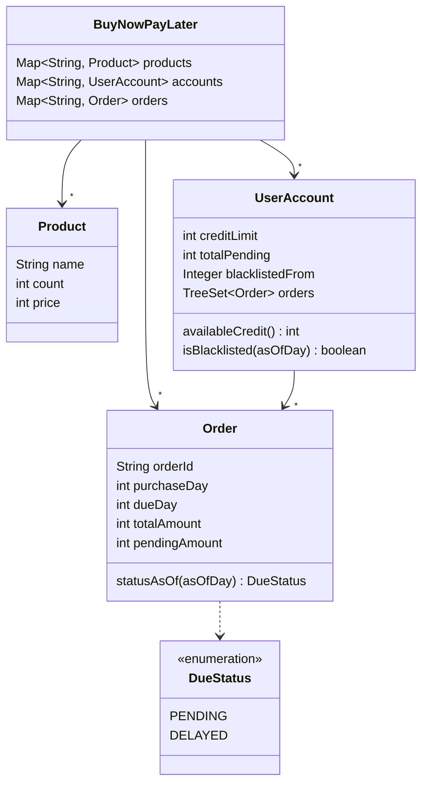

# Design Flipkart Buy Now Pay Later in Java

#### Problem Statement
[https://codezym.com/question/80-design-flipkart-buy-now-pay-later](https://codezym.com/question/80-design-flipkart-buy-now-pay-later)


## Core Idea

This problem is about keeping records of products, users and orders, and following the BNPL rules carefully. We split the work into a few small classes: a product, an order, a user account and an enum for the order status.

No design pattern is needed here. Plain classes keep the code short and easy to read.


## The Rules in Simple Words

- Every order must be paid within 30 days, so `dueDay = purchaseDay + 30`.
- Available credit is the credit limit minus everything the user still owes.
- A buy is all or nothing. If even one item fails, nothing changes.
- An unpaid order is `PENDING` up to its due day, and `DELAYED` after it.
- A user with 3 or more `DELAYED` unpaid orders is blacklisted. They leave the blacklist only after paying everything.


## Classes We Need

- **`Product`** stores the name, count and price of one item.
- **`Order`** stores everything about one order. It also works out its own status and prints its own `ORDER` and `DUE` lines.
- **`DueStatus`** is an enum with `PENDING` and `DELAYED`, so a typo in a status cannot slip through.
- **`UserAccount`** stores one user's credit limit, orders and unpaid total. Because it keeps a running unpaid total, the available credit is a simple subtraction.
- **`BuyNowPayLater`** is the entry point. It keeps three maps: products by name, accounts by user name and orders by id.

The orders map covers all users. It lets `buy` reject a reused `orderId` and lets `clearDues` find any order quickly.

Each `UserAccount` keeps its orders in a sorted set (`TreeSet`), newest first. So `accountSummary` can print them without sorting.




## How It Works

### Buying: check first, then change

`buy` first runs every check without changing anything: a new `orderId`, a known user, valid quantities, enough stock, no blacklist and enough credit. Only when all of them pass do we reduce the stock and save the order. So a failed buy never leaves anything half done.

Before checking the stock, we merge repeated items. A cart like `["Book,6", "Book,6"]` needs 12 books, not 6.

### Status is calculated, not stored

An order due on day 130 is `PENDING` when we ask about day 120, and `DELAYED` when we ask about day 140. So we never save the status. We work it out from `asOfDay` every time.

### A blacklist that sticks

Look at this case:

| Day | What happens | Defaults | Blacklisted? |
|---|---|---|---|
| 140 | Neha has 3 unpaid orders past their due day | 3 | yes |
| 140 | Neha pays one of them | 2 | still yes |
| 147 | Neha pays the other two | 0 | no |

A plain count of defaults would free Neha after her first payment. But the rule says she leaves the blacklist only after paying everything.

So `clearDues` first checks if the user is a defaulter on `clearingDay`. If yes, it saves that day as `blacklistedFrom`. The user then stays blacklisted from that day until the unpaid total becomes 0.

In short, a user is blacklisted if `asOfDay` is on or after `blacklistedFrom`, or if they have 3 or more defaults as of `asOfDay`.


## Why No Design Pattern?

**State pattern:** it fits objects that move from step to step because of events. Here the status only depends on which day we ask about, so a small enum is enough.

**Strategy pattern:** it fits when there are many ways to do one job. Here there is only one payment method and one blacklist rule, so an extra interface would add code without any benefit.


## Code

```java
import java.util.*;

/**
 * Entry point of the system. It checks the input and lets
 * Product, UserAccount and Order do the real work.
 */
public class BuyNowPayLater {

    Map<String, Product> products = new HashMap<>();     // product name -> product
    Map<String, UserAccount> accounts = new HashMap<>(); // user name -> account
    Map<String, Order> orders = new HashMap<>();         // orderId -> order, for all users

    public BuyNowPayLater() {
    }

    public void seedInventory(List<String> inventoryLines) {
        for (String line : inventoryLines) {
            String[] parts = line.split(",");
            String name = parts[0].trim();
            int count = Integer.parseInt(parts[1].trim());
            int price = Integer.parseInt(parts[2].trim());
            if (name.isEmpty() || count < 0 || price <= 0) continue;

            Product product = products.get(name);
            if (product == null) {
                products.put(name, new Product(name, count, price));
            } else {
                product.count += count; // merge counts
                product.price = price;  // latest price wins
            }
        }
    }

    public List<String> viewInventory() {
        List<String> names = new ArrayList<>(products.keySet());
        Collections.sort(names);
        List<String> result = new ArrayList<>();
        for (String name : names) {
            Product product = products.get(name);
            result.add(product.name + "," + product.count + "," + product.price);
        }
        return result;
    }

    public void registerUser(String user, int creditLimit) {
        if (accounts.containsKey(user) || creditLimit < 0) return;
        accounts.put(user, new UserAccount(creditLimit));
    }

    public boolean buy(String orderId, String user, List<String> itemsWithQuantity, int purchaseDay) {
        UserAccount account = accounts.get(user);
        if (account == null || purchaseDay < 0 || orders.containsKey(orderId)) return false;
        if (isBlacklisted(user, purchaseDay)) return false;

        Map<String, Integer> items = parseItems(itemsWithQuantity);
        if (items == null) return false;

        // step 1: check everything, change nothing
        long total = 0;
        for (String name : items.keySet()) {
            Product product = products.get(name);
            int quantity = items.get(name);
            if (product == null || product.count < quantity) return false;
            total += (long) quantity * product.price;
        }
        if (total > account.availableCredit()) return false;

        // step 2: every check passed, now apply the purchase
        for (String name : items.keySet()) {
            products.get(name).count -= items.get(name);
        }
        // total is at most the credit limit, so it fits in an int
        Order order = new Order(orderId, user, purchaseDay, (int) total, items);
        orders.put(orderId, order);
        account.addOrder(order);
        return true;
    }

    public void clearDues(String user, List<String> orderIdsToClear, int clearingDay) {
        UserAccount account = accounts.get(user);
        if (account == null || clearingDay < 0) return;

        // must run before any payment, so that a part payment cannot lift the blacklist
        account.lockBlacklistIfDefaulter(clearingDay);

        for (String orderId : orderIdsToClear) {
            Order order = orders.get(orderId);
            // skip unknown ids, orders of other users and orders already cleared
            if (order == null || !order.user.equals(user) || order.pendingAmount == 0) continue;
            account.payOrder(order);
        }
    }

    public List<String> accountSummary(String user, int asOfDay) {
        List<String> result = new ArrayList<>();
        UserAccount account = accounts.get(user);
        if (account == null) return result;

        result.add("CREDIT_AVAILABLE," + account.availableCredit());
        for (Order order : account.orders) { // already sorted, newest first
            result.add(order.orderLine());
            if (order.hasDueAsOf(asOfDay)) result.add(order.dueLine(asOfDay));
        }
        return result;
    }

    public boolean isBlacklisted(String user, int asOfDay) {
        UserAccount account = accounts.get(user);
        return account != null && account.isBlacklisted(asOfDay);
    }

    /** Turns ["Book,1", "Pen,2", "Book,3"] into {Book=4, Pen=2}. Returns null if anything is invalid. */
    Map<String, Integer> parseItems(List<String> itemsWithQuantity) {
        if (itemsWithQuantity == null || itemsWithQuantity.isEmpty()) return null;
        Map<String, Integer> items = new HashMap<>();
        for (String entry : itemsWithQuantity) {
            String[] parts = entry.split(",");
            if (parts.length != 2) return null;
            String name = parts[0].trim();
            int quantity;
            try {
                quantity = Integer.parseInt(parts[1].trim());
            } catch (NumberFormatException e) {
                return null; // quantity is not an integer
            }
            if (name.isEmpty() || quantity <= 0) return null;

            long merged = (long) items.getOrDefault(name, 0) + quantity;
            if (merged > Integer.MAX_VALUE) return null; // no stock can be that big
            items.put(name, (int) merged);
        }
        return items;
    }
}

/** One product in the inventory. */
class Product {
    String name;
    int count;
    int price;

    Product(String name, int count, int price) {
        this.name = name;
        this.count = count;
        this.price = price;
    }
}

/** Where an unpaid order stands on a given day. */
enum DueStatus {
    PENDING, // asOfDay <= dueDay
    DELAYED  // asOfDay > dueDay
}

/** One BNPL order together with its due. */
class Order {
    String orderId;
    String user;
    int purchaseDay;
    int dueDay;
    int totalAmount;
    int pendingAmount; // becomes 0 when the due is cleared
    String itemsText;  // like "Book:1|Pen:2", item names sorted

    Order(String orderId, String user, int purchaseDay, int totalAmount, Map<String, Integer> items) {
        this.orderId = orderId;
        this.user = user;
        this.purchaseDay = purchaseDay;
        this.dueDay = purchaseDay + 30; // BNPL window is 30 days
        this.totalAmount = totalAmount;
        this.pendingAmount = totalAmount;
        this.itemsText = formatItems(items);
    }

    /** Status is never stored. It depends on the day we ask about. */
    DueStatus statusAsOf(int asOfDay) {
        return asOfDay <= dueDay ? DueStatus.PENDING : DueStatus.DELAYED;
    }

    /** A default is an unpaid order whose due day has passed. */
    boolean isDefaultAsOf(int asOfDay) {
        return pendingAmount > 0 && statusAsOf(asOfDay) == DueStatus.DELAYED;
    }

    /** accountSummary shows a DUE line only for unpaid orders placed on or before asOfDay. */
    boolean hasDueAsOf(int asOfDay) {
        return pendingAmount > 0 && purchaseDay <= asOfDay;
    }

    String orderLine() {
        return "ORDER," + orderId + "," + purchaseDay + "," + totalAmount + "," + itemsText;
    }

    String dueLine(int asOfDay) {
        return "DUE," + orderId + "," + purchaseDay + "," + dueDay + "," + pendingAmount + ","
                + statusAsOf(asOfDay) + "," + itemsText;
    }

    /** Builds "Item1:Q1|Item2:Q2" with item names in sorted order. */
    String formatItems(Map<String, Integer> items) {
        List<String> names = new ArrayList<>(items.keySet());
        Collections.sort(names);
        List<String> parts = new ArrayList<>();
        for (String name : names) parts.add(name + ":" + items.get(name));
        return String.join("|", parts);
    }
}

/** Credit, orders and blacklist state of one user. */
class UserAccount {
    int creditLimit;
    int totalPending = 0;           // sum of pendingAmount over this user's orders
    Integer blacklistedFrom = null; // day from which the blacklist sticks, null if it does not

    // this user's orders: newest purchaseDay first, ties broken by orderId
    TreeSet<Order> orders = new TreeSet<>((a, b) -> a.purchaseDay != b.purchaseDay
            ? Integer.compare(b.purchaseDay, a.purchaseDay)
            : a.orderId.compareTo(b.orderId));

    UserAccount(int creditLimit) {
        this.creditLimit = creditLimit;
    }

    int availableCredit() {
        return creditLimit - totalPending;
    }

    void addOrder(Order order) {
        orders.add(order);
        totalPending += order.pendingAmount;
    }

    void payOrder(Order order) {
        totalPending -= order.pendingAmount;
        order.pendingAmount = 0;
        if (totalPending == 0) blacklistedFrom = null; // every due is cleared
    }

    int countDefaults(int asOfDay) {
        int count = 0;
        for (Order order : orders) {
            if (order.isDefaultAsOf(asOfDay)) count++;
        }
        return count;
    }

    boolean isBlacklisted(int asOfDay) {
        boolean locked = blacklistedFrom != null && asOfDay >= blacklistedFrom;
        return locked || countDefaults(asOfDay) >= 3;
    }

    /** Called just before a payment. If the user is a defaulter on that day, the blacklist sticks. */
    void lockBlacklistIfDefaulter(int clearingDay) {
        if (countDefaults(clearingDay) < 3) return;
        if (blacklistedFrom == null || clearingDay < blacklistedFrom) blacklistedFrom = clearingDay;
    }
}
```


## Dry Run with Example 3

The store has 10 books at 100 each. Neha has a credit limit of 1000.

| Call | What happens | Result |
|---|---|---|
| `buy` OD_1, OD_2, OD_3 on days 100, 101, 102 | each costs 100, due days are 130, 131 and 132 | `true` each time |
| `accountSummary(Neha, 140)` | credit is 1000 - 300 = 700, all 3 orders are past their due day | 3 orders, each with a `DELAYED` due line |
| `isBlacklisted(Neha, 140)` | 3 defaults | `true` |
| `buy(OD_4, Neha, [Book,1], 140)` | Neha is blacklisted | `false` |
| `clearDues(Neha, [OD_1, OD_2, OD_3], 140)` | all 3 orders are paid, the unpaid total becomes 0, so the blacklist is lifted | no return |
| `isBlacklisted(Neha, 140)` | 0 defaults | `false` |
| `accountSummary(Neha, 140)` | credit is back to 1000 | 3 orders, no due lines |


## Complexity

`K` is the number of orders of one user, `M` the number of lines in one cart, `P` the number of products and `C` the number of ids passed to `clearDues`.

| Method | Time |
|---|---|
| `seedInventory` | O(number of lines) |
| `viewInventory` | O(P log P) |
| `registerUser` | O(1) |
| `buy` | O(K + M log M) |
| `clearDues` | O(K + C) |
| `accountSummary` | O(K) |
| `isBlacklisted` | O(K) |

`buy`, `clearDues` and `isBlacklisted` count defaults, and `accountSummary` walks the orders. Both only touch the orders of one user.


## Things That Are Easy to Miss

- A failed `buy` does not use up its `orderId`.
- An order keeps the price it was bought at, even if `seedInventory` changes the price later.
- A product with count 0 still shows up in `viewInventory`.
- An order placed after `asOfDay` still gets its `ORDER` line, but no `DUE` line.
- Clearing an unknown order, another user's order or an already cleared order does nothing.
- Price times quantity is calculated as a `long`, because it can overflow an `int`.