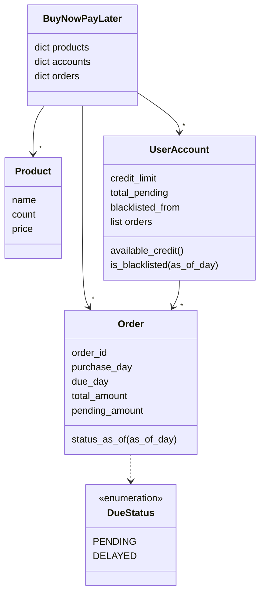

# Design Flipkart Buy Now Pay Later in Python

#### Problem Statement
[https://codezym.com/question/80-design-flipkart-buy-now-pay-later](https://codezym.com/question/80-design-flipkart-buy-now-pay-later)


## Core Idea

This problem is about keeping records of products, users and orders, and following the BNPL rules carefully. We split the work into a few small classes: a product, an order, a user account and an enum for the order status.

No design pattern is needed here. Plain classes keep the code short and easy to read.


## The Rules in Simple Words

- Every order must be paid within 30 days, so `dueDay = purchaseDay + 30`.
- Available credit is the credit limit minus everything the user still owes.
- A buy is all or nothing. If even one item fails, nothing changes.
- An unpaid order is `PENDING` up to its due day, and `DELAYED` after it.
- A user with 3 or more `DELAYED` unpaid orders is blacklisted. They leave the blacklist only after paying everything.


## Classes We Need

- **`Product`** stores the name, count and price of one item.
- **`Order`** stores everything about one order. It also works out its own status and prints its own `ORDER` and `DUE` lines.
- **`DueStatus`** is an `Enum` with `PENDING` and `DELAYED`, so a typo in a status cannot slip through.
- **`UserAccount`** stores one user's credit limit, orders and unpaid total. Because it keeps a running unpaid total, the available credit is a simple subtraction.
- **`BuyNowPayLater`** is the entry point. It keeps three dictionaries: products by name, accounts by user name and orders by id.

The orders dictionary covers all users. It lets `buy` reject a reused `orderId` and lets `clearDues` find any order quickly.

Each `UserAccount` keeps its orders in a plain list. `accountSummary` sorts them newest first, with ties broken by order id.




## How It Works

### Buying: check first, then change

`buy` first runs every check without changing anything: a new `orderId`, a known user, valid quantities, enough stock, no blacklist and enough credit. Only when all of them pass do we reduce the stock and save the order. So a failed buy never leaves anything half done.

Before checking the stock, we merge repeated items. A cart like `["Book,6", "Book,6"]` needs 12 books, not 6.

### Status is calculated, not stored

An order due on day 130 is `PENDING` when we ask about day 120, and `DELAYED` when we ask about day 140. So we never save the status. We work it out from `asOfDay` every time.

### A blacklist that sticks

Look at this case:

| Day | What happens | Defaults | Blacklisted? |
|---|---|---|---|
| 140 | Neha has 3 unpaid orders past their due day | 3 | yes |
| 140 | Neha pays one of them | 2 | still yes |
| 147 | Neha pays the other two | 0 | no |

A plain count of defaults would free Neha after her first payment. But the rule says she leaves the blacklist only after paying everything.

So `clearDues` first checks if the user is a defaulter on `clearingDay`. If yes, it saves that day as `blacklisted_from`. The user then stays blacklisted from that day until the unpaid total becomes 0.

In short, a user is blacklisted if `asOfDay` is on or after `blacklisted_from`, or if they have 3 or more defaults as of `asOfDay`.


## Why No Design Pattern?

**State pattern:** it fits objects that move from step to step because of events. Here the status only depends on which day we ask about, so a small enum is enough.

**Strategy pattern:** it fits when there are many ways to do one job. Here there is only one payment method and one blacklist rule, so an extra base class would add code without any benefit.


## Code

```python
from enum import Enum


class Product:
    """One product in the inventory."""

    def __init__(self, name, count, price):
        self.name = name
        self.count = count
        self.price = price


class DueStatus(Enum):
    """Where an unpaid order stands on a given day."""
    PENDING = "PENDING"  # as_of_day <= due_day
    DELAYED = "DELAYED"  # as_of_day > due_day


class Order:
    """One BNPL order together with its due."""

    def __init__(self, order_id, user, purchase_day, total_amount, items):
        self.order_id = order_id
        self.user = user
        self.purchase_day = purchase_day
        self.due_day = purchase_day + 30  # BNPL window is 30 days
        self.total_amount = total_amount
        self.pending_amount = total_amount  # becomes 0 when the due is cleared
        # like "Book:1|Pen:2", item names sorted
        self.items_text = "|".join(
            f"{name}:{items[name]}" for name in sorted(items))

    def status_as_of(self, as_of_day):
        """Status is never stored. It depends on the day we ask about."""
        if as_of_day <= self.due_day:
            return DueStatus.PENDING
        return DueStatus.DELAYED

    def is_default_as_of(self, as_of_day):
        """A default is an unpaid order whose due day has passed."""
        return (self.pending_amount > 0
                and self.status_as_of(as_of_day) == DueStatus.DELAYED)

    def has_due_as_of(self, as_of_day):
        """Only unpaid orders placed on or before as_of_day get a DUE line."""
        return self.pending_amount > 0 and self.purchase_day <= as_of_day

    def order_line(self):
        return (f"ORDER,{self.order_id},{self.purchase_day},"
                f"{self.total_amount},{self.items_text}")

    def due_line(self, as_of_day):
        status = self.status_as_of(as_of_day).value
        return (f"DUE,{self.order_id},{self.purchase_day},{self.due_day},"
                f"{self.pending_amount},{status},{self.items_text}")


class UserAccount:
    """Credit, orders and blacklist state of one user."""

    def __init__(self, credit_limit):
        self.credit_limit = credit_limit
        self.total_pending = 0  # sum of pending_amount over this user's orders
        self.blacklisted_from = None  # day from which the blacklist sticks
        self.orders = []

    def available_credit(self):
        return self.credit_limit - self.total_pending

    def add_order(self, order):
        self.orders.append(order)
        self.total_pending += order.pending_amount

    def pay_order(self, order):
        self.total_pending -= order.pending_amount
        order.pending_amount = 0
        if self.total_pending == 0:
            self.blacklisted_from = None  # every due is cleared

    def count_defaults(self, as_of_day):
        return sum(1 for order in self.orders
                   if order.is_default_as_of(as_of_day))

    def is_blacklisted(self, as_of_day):
        locked = (self.blacklisted_from is not None
                  and as_of_day >= self.blacklisted_from)
        return locked or self.count_defaults(as_of_day) >= 3

    def lock_blacklist_if_defaulter(self, clearing_day):
        """Called just before a payment.
        If the user is a defaulter on that day, the blacklist sticks."""
        if self.count_defaults(clearing_day) < 3:
            return
        if (self.blacklisted_from is None
                or clearing_day < self.blacklisted_from):
            self.blacklisted_from = clearing_day

    def sorted_orders(self):
        """Newest purchase day first, ties broken by order id."""
        return sorted(self.orders,
                      key=lambda order: (-order.purchase_day, order.order_id))


class BuyNowPayLater:
    """Entry point. It checks the input and lets
    Product, UserAccount and Order do the real work."""

    def __init__(self):
        self.products = {}  # product name -> Product
        self.accounts = {}  # user name -> UserAccount
        self.orders = {}    # order id -> Order, for all users

    def seedInventory(self, inventoryLines):
        for line in inventoryLines:
            name, count, price = line.split(",")
            name, count, price = name.strip(), int(count), int(price)
            if not name or count < 0 or price <= 0:
                continue

            product = self.products.get(name)
            if product is None:
                self.products[name] = Product(name, count, price)
            else:
                product.count += count  # merge counts
                product.price = price   # latest price wins

    def viewInventory(self):
        result = []
        for name in sorted(self.products):
            product = self.products[name]
            result.append(f"{product.name},{product.count},{product.price}")
        return result

    def registerUser(self, user, creditLimit):
        if user in self.accounts or creditLimit < 0:
            return
        self.accounts[user] = UserAccount(creditLimit)

    def buy(self, orderId, user, itemsWithQuantity, purchaseDay):
        account = self.accounts.get(user)
        if account is None or purchaseDay < 0 or orderId in self.orders:
            return False
        if self.isBlacklisted(user, purchaseDay):
            return False

        items = self.parse_items(itemsWithQuantity)
        if items is None:
            return False

        # step 1: check everything, change nothing
        total = 0
        for name, quantity in items.items():
            product = self.products.get(name)
            if product is None or product.count < quantity:
                return False
            total += quantity * product.price
        if total > account.available_credit():
            return False

        # step 2: every check passed, now apply the purchase
        for name, quantity in items.items():
            self.products[name].count -= quantity
        order = Order(orderId, user, purchaseDay, total, items)
        self.orders[orderId] = order
        account.add_order(order)
        return True

    def clearDues(self, user, orderIdsToClear, clearingDay):
        account = self.accounts.get(user)
        if account is None or clearingDay < 0:
            return

        # must run before any payment,
        # so that a part payment cannot lift the blacklist
        account.lock_blacklist_if_defaulter(clearingDay)

        for order_id in orderIdsToClear:
            order = self.orders.get(order_id)
            # skip unknown ids, other users' orders and cleared orders
            if order is None or order.user != user:
                continue
            if order.pending_amount == 0:
                continue
            account.pay_order(order)

    def accountSummary(self, user, asOfDay):
        account = self.accounts.get(user)
        if account is None:
            return []

        result = [f"CREDIT_AVAILABLE,{account.available_credit()}"]
        for order in account.sorted_orders():
            result.append(order.order_line())
            if order.has_due_as_of(asOfDay):
                result.append(order.due_line(asOfDay))
        return result

    def isBlacklisted(self, user, asOfDay):
        account = self.accounts.get(user)
        return account is not None and account.is_blacklisted(asOfDay)

    def parse_items(self, itemsWithQuantity):
        """Turns ["Book,1", "Pen,2", "Book,3"] into {"Book": 4, "Pen": 2}.
        Returns None if anything is invalid."""
        if not itemsWithQuantity:
            return None
        items = {}
        for entry in itemsWithQuantity:
            parts = entry.split(",")
            if len(parts) != 2:
                return None
            name = parts[0].strip()
            try:
                quantity = int(parts[1])
            except ValueError:
                return None  # quantity is not an integer
            if not name or quantity <= 0:
                return None
            items[name] = items.get(name, 0) + quantity
        return items
```


## Dry Run with Example 3

The store has 10 books at 100 each. Neha has a credit limit of 1000.

| Call | What happens | Result |
|---|---|---|
| `buy` OD_1, OD_2, OD_3 on days 100, 101, 102 | each costs 100, due days are 130, 131 and 132 | `True` each time |
| `accountSummary("Neha", 140)` | credit is 1000 - 300 = 700, all 3 orders are past their due day | 3 orders, each with a `DELAYED` due line |
| `isBlacklisted("Neha", 140)` | 3 defaults | `True` |
| `buy("OD_4", "Neha", ["Book,1"], 140)` | Neha is blacklisted | `False` |
| `clearDues("Neha", ["OD_1", "OD_2", "OD_3"], 140)` | all 3 orders are paid, the unpaid total becomes 0, so the blacklist is lifted | `None` |
| `isBlacklisted("Neha", 140)` | 0 defaults | `False` |
| `accountSummary("Neha", 140)` | credit is back to 1000 | 3 orders, no due lines |


## Complexity

`K` is the number of orders of one user, `M` the number of lines in one cart, `P` the number of products and `C` the number of ids passed to `clearDues`.

| Method | Time |
|---|---|
| `seedInventory` | O(number of lines) |
| `viewInventory` | O(P log P) |
| `registerUser` | O(1) |
| `buy` | O(K + M log M) |
| `clearDues` | O(K + C) |
| `accountSummary` | O(K log K) |
| `isBlacklisted` | O(K) |

`buy`, `clearDues` and `isBlacklisted` count defaults, and `accountSummary` sorts the orders. Both only touch the orders of one user.


## Things That Are Easy to Miss

- A failed `buy` does not use up its `orderId`.
- An order keeps the price it was bought at, even if `seedInventory` changes the price later.
- A product with count 0 still shows up in `viewInventory`.
- An order placed after `asOfDay` still gets its `ORDER` line, but no `DUE` line.
- Clearing an unknown order, another user's order or an already cleared order does nothing.
- A quantity like `"1.5"` or `"abc"` makes `int()` raise `ValueError`, so `buy` returns `False`.