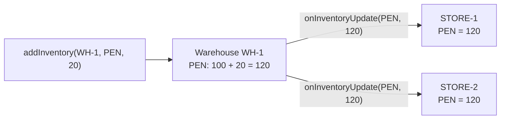

# Design Warehouse Stores Inventory Update in Java

#### Problem Statement
[https://codezym.com/question/96-design-warehouse-inventory-updater](https://codezym.com/question/96-design-warehouse-inventory-updater)


## Core Idea

The whole problem is one rule: **when a warehouse changes, all of its stores must change too.**


The cleanest way to do this is to let each store **subscribe** to its warehouse once, when it registers. After that, whenever stock is added, the warehouse simply tells all of its subscribers the new quantity.


This is the **Observer design pattern**. The warehouse is the **subject** that publishes changes. Each store is an **observer** that listens to them.


Observer alone is the right fit here, so we do not combine it with any other pattern. Everything else is plain classes and hash maps.


## Solution 1: Simple Maps (Brute Force)

Let's start with the most direct idea: keep everything inside one class using three maps.

```java
// warehouseId -> (productId -> quantity)
Map<String, Map<String, Long>> warehouseInventory = new HashMap<>();
// storeId -> (productId -> quantity)
Map<String, Map<String, Long>> storeInventory = new HashMap<>();
// storeId -> warehouseId
Map<String, String> storeToWarehouse = new HashMap<>();
```

When stock is added, we update the warehouse. Then we go through **every store in the system** and update the ones mapped to this warehouse.

```java
public boolean addInventory(String warehouseId, String productId, int quantity) {
    if (!warehouseInventory.containsKey(warehouseId) || quantity <= 0) {
        return false;
    }
    Map<String, Long> inventory = warehouseInventory.get(warehouseId);
    long total = inventory.getOrDefault(productId, 0L) + quantity;
    inventory.put(productId, total);

    // scan ALL stores, even the ones that belong to other warehouses
    for (String storeId : storeToWarehouse.keySet()) {
        if (storeToWarehouse.get(storeId).equals(warehouseId)) {
            storeInventory.get(storeId).put(productId, total);
        }
    }
    return true;
}
```

This works, but it has two problems.


**1. It is slow.** Every single update scans all stores in the system, including the stores of other warehouses. `getStoresForWarehouse()` needs the same full scan.


**2. It is hard to extend.** The "who needs to know" logic is hard-coded inside `addInventory()`. If tomorrow a sales dashboard or a low stock alert also needs these updates, we have to keep editing this method.


A quick fix for the speed problem is to keep a list of stores for each warehouse. Now take that idea one step further: let the warehouse own this list and send the updates itself. That is exactly the Observer pattern.


## Solution 2: Observer Pattern

Each warehouse keeps a map of its own observers. When stock changes, it loops over **only its own stores** and sends each one the new total.



The warehouse never talks to `Store` directly. It only talks to the `InventoryObserver` interface. So if we later add a new listener, like a dashboard, `Warehouse` does not change at all.


### Why Not Mediator?

Mediator puts one central "hub" in the middle, and every object talks through it. It sounds like a match, because we have many warehouses and many stores.


But updates here flow only one way: from one warehouse to its own stores. Stores never reply, and warehouses never talk to each other. A hub would only add an extra step in between, and it would have to track every warehouse and store link by itself. Observer models this one-to-many link directly.


### The Classes

**`InventoryObserver` (interface)**

It has one method: `onInventoryUpdate(productId, quantity)`. Any class that wants warehouse updates implements it.


**`Warehouse` (subject)**

- `inventory`: `HashMap` of productId to total quantity. This is the real stock.
- `observers`: `HashMap` of store id to observer. Because it is keyed by store id, the same map also answers `getStoresForWarehouse()`.
- `addInventory()` updates the total, then calls `notifyObservers()`.


**`Store` (observer)**

- `inventory`: its own `HashMap` copy of the warehouse stock.
- `onInventoryUpdate()` simply overwrites the quantity for that product.


**`WarehouseStoreInventoryUpdate` (main class)**

- Two maps, `warehouses` and `stores`, to find any warehouse or store by id in O(1).
- Rejects bad input: unknown warehouse, already registered store, or `quantity <= 0`.
- Turns inventory maps into sorted output strings.


### Small Details That Matter

**A new store starts in sync.** When a store subscribes, `addObserver()` right away sends it every product the warehouse already has. So a store that registers late still sees the existing stock.


**Send the total, not the change.** The warehouse sends `PEN = 120`, not `+20`. The store does no math. It just overwrites the value, so its copy always matches the warehouse.


**Use `long` for quantities.** One call can add up to 10^9, so a few calls can go past the `int` limit (about 2.1 billion). That is why totals are stored as `long`.


**Sort only when reading.** Inventory and observers are plain `HashMap`s. We sort product ids or store ids only inside the `get` methods. This keeps updates fast without needing any special sorted map.


### Complexity

`K` = number of stores mapped to the warehouse, `P` = number of products in the warehouse.

| Method | Time |
|---|---|
| `registerStore` | O(P), copies current stock into the new store |
| `addInventory` | O(K), one update per mapped store |
| `getWarehouseInventory`, `getStoreInventory` | O(P log P), for sorting |
| `getStoresForWarehouse` | O(K log K), for sorting |


`addInventory` is O(K) because every store keeps its own copy. But unlike Solution 1, it only touches the stores that actually need the update.


### Java Code

```java
import java.util.*;

/**
 * Observer: anything that wants to hear about inventory changes.
 */
interface InventoryObserver {
    void onInventoryUpdate(String productId, long quantity);
}

/**
 * Subject (publisher).
 * Owns the real inventory and tells every observer when it changes.
 */
class Warehouse {
    String warehouseId;
    // productId -> total quantity
    Map<String, Long> inventory = new HashMap<>();
    // observerId -> observer. In this problem every observer is a store.
    Map<String, InventoryObserver> observers = new HashMap<>();

    Warehouse(String warehouseId) {
        this.warehouseId = warehouseId;
    }

    /**
     * Subscribes an observer and sends it the current stock,
     * so a new store starts fully in sync.
     */
    void addObserver(String observerId, InventoryObserver observer) {
        observers.put(observerId, observer);
        for (String productId : inventory.keySet()) {
            observer.onInventoryUpdate(productId, inventory.get(productId));
        }
    }

    /** Adds stock for a product, then pushes the new total to every observer. */
    void addInventory(String productId, int quantity) {
        // long, because many additions of up to 10^9 can go past the int limit
        long total = inventory.getOrDefault(productId, 0L) + quantity;
        inventory.put(productId, total);
        notifyObservers(productId, total);
    }

    void notifyObservers(String productId, long quantity) {
        for (InventoryObserver observer : observers.values()) {
            observer.onInventoryUpdate(productId, quantity);
        }
    }

    /** Returns the ids of all observers in sorted order. */
    List<String> getObserverIds() {
        List<String> ids = new ArrayList<>(observers.keySet());
        Collections.sort(ids);
        return ids;
    }
}

/**
 * Concrete observer.
 * Keeps a mirrored copy of its warehouse inventory.
 */
class Store implements InventoryObserver {
    String storeId;
    // productId -> quantity, mirrored from the warehouse
    Map<String, Long> inventory = new HashMap<>();

    Store(String storeId) {
        this.storeId = storeId;
    }

    /** The warehouse always sends the latest total, so we simply overwrite. */
    @Override
    public void onInventoryUpdate(String productId, long quantity) {
        inventory.put(productId, quantity);
    }
}

/**
 * Entry point of the system.
 * Finds warehouses and stores by id, validates input and formats output.
 */
public class WarehouseStoreInventoryUpdate {
    // warehouseId -> Warehouse
    Map<String, Warehouse> warehouses = new HashMap<>();
    // storeId -> Store
    Map<String, Store> stores = new HashMap<>();

    public WarehouseStoreInventoryUpdate(List<String> warehouseIds) {
        for (String warehouseId : warehouseIds) {
            warehouses.put(warehouseId, new Warehouse(warehouseId));
        }
    }

    public boolean registerStore(String storeId, String warehouseId) {
        Warehouse warehouse = warehouses.get(warehouseId);
        if (warehouse == null || stores.containsKey(storeId)) {
            return false;
        }
        Store store = new Store(storeId);
        stores.put(storeId, store);
        // subscribing also copies the current warehouse stock into the store
        warehouse.addObserver(storeId, store);
        return true;
    }

    public boolean addInventory(String warehouseId, String productId, int quantity) {
        Warehouse warehouse = warehouses.get(warehouseId);
        if (warehouse == null || quantity <= 0) {
            return false;
        }
        // the warehouse updates itself and then notifies all its stores
        warehouse.addInventory(productId, quantity);
        return true;
    }

    public List<String> getWarehouseInventory(String warehouseId) {
        Warehouse warehouse = warehouses.get(warehouseId);
        if (warehouse == null) {
            return new ArrayList<>();
        }
        return formatInventory(warehouse.inventory);
    }

    public List<String> getStoreInventory(String storeId) {
        Store store = stores.get(storeId);
        if (store == null) {
            return new ArrayList<>();
        }
        return formatInventory(store.inventory);
    }

    public List<String> getStoresForWarehouse(String warehouseId) {
        Warehouse warehouse = warehouses.get(warehouseId);
        if (warehouse == null) {
            return new ArrayList<>();
        }
        // only stores subscribe to a warehouse, so observer ids are store ids
        return warehouse.getObserverIds();
    }

    /**
     * Turns a productId -> quantity map into
     * "productId=<id>, quantity=<qty>" strings, sorted by productId.
     */
    List<String> formatInventory(Map<String, Long> inventory) {
        List<String> productIds = new ArrayList<>(inventory.keySet());
        Collections.sort(productIds);

        List<String> result = new ArrayList<>();
        for (String productId : productIds) {
            result.add("productId=" + productId + ", quantity=" + inventory.get(productId));
        }
        return result;
    }
}
```