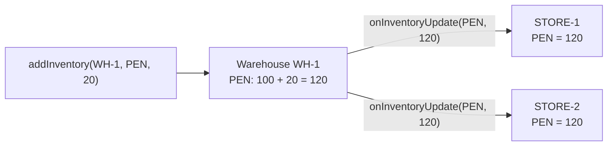

# Design Warehouse Stores Inventory Update in Python

#### Problem Statement
[https://codezym.com/question/96-design-warehouse-inventory-updater](https://codezym.com/question/96-design-warehouse-inventory-updater)


## Core Idea

The whole problem is one rule: **when a warehouse changes, all of its stores must change too.**


The cleanest way to do this is to let each store **subscribe** to its warehouse once, when it registers. After that, whenever stock is added, the warehouse simply tells all of its subscribers the new quantity.


This is the **Observer design pattern**. The warehouse is the **subject** that publishes changes. Each store is an **observer** that listens to them.


Observer alone is the right fit here, so we do not combine it with any other pattern. Everything else is plain classes and dictionaries.


## Solution 1: Simple Dictionaries (Brute Force)

Let's start with the most direct idea: keep everything inside one class using three dictionaries.

```python
# warehouseId -> {productId: quantity}
self.warehouseInventory: Dict[str, Dict[str, int]] = {}
# storeId -> {productId: quantity}
self.storeInventory: Dict[str, Dict[str, int]] = {}
# storeId -> warehouseId
self.storeToWarehouse: Dict[str, str] = {}
```

When stock is added, we update the warehouse. Then we go through **every store in the system** and update the ones mapped to this warehouse.

```python
def addInventory(self, warehouseId: str, productId: str, quantity: int) -> bool:
    if warehouseId not in self.warehouseInventory or quantity <= 0:
        return False
    inventory = self.warehouseInventory[warehouseId]
    total = inventory.get(productId, 0) + quantity
    inventory[productId] = total

    # scan ALL stores, even the ones that belong to other warehouses
    for storeId, mappedWarehouseId in self.storeToWarehouse.items():
        if mappedWarehouseId == warehouseId:
            self.storeInventory[storeId][productId] = total
    return True
```

This works, but it has two problems.


**1. It is slow.** Every single update scans all stores in the system, including the stores of other warehouses. `getStoresForWarehouse()` needs the same full scan.


**2. It is hard to extend.** The "who needs to know" logic is hard-coded inside `addInventory()`. If tomorrow a sales dashboard or a low stock alert also needs these updates, we have to keep editing this method.


A quick fix for the speed problem is to keep a list of stores for each warehouse. Now take that idea one step further: let the warehouse own this list and send the updates itself. That is exactly the Observer pattern.


## Solution 2: Observer Pattern

Each warehouse keeps a dictionary of its own observers. When stock changes, it loops over **only its own stores** and sends each one the new total.



The warehouse never talks to `Store` directly. It only talks to the `InventoryObserver` abstract class. So if we later add a new listener, like a dashboard, `Warehouse` does not change at all.


### Why Not Mediator?

Mediator puts one central "hub" in the middle, and every object talks through it. It sounds like a match, because we have many warehouses and many stores.


But updates here flow only one way: from one warehouse to its own stores. Stores never reply, and warehouses never talk to each other. A hub would only add an extra step in between, and it would have to track every warehouse and store link by itself. Observer models this one-to-many link directly.


### The Classes

**`InventoryObserver` (abstract class)**

It has one abstract method: `onInventoryUpdate(productId, quantity)`. Any class that wants warehouse updates extends it and fills in this method.


**`Warehouse` (subject)**

- `inventory`: dictionary of productId to total quantity. This is the real stock.
- `observers`: dictionary of store id to observer. Because it is keyed by store id, the same dictionary also answers `getStoresForWarehouse()`.
- `addInventory()` updates the total, then calls `notifyObservers()`.


**`Store` (observer)**

- `inventory`: its own dictionary copy of the warehouse stock.
- `onInventoryUpdate()` simply overwrites the quantity for that product.


**`WarehouseStoreInventoryUpdate` (main class)**

- Two dictionaries, `warehouses` and `stores`, to find any warehouse or store by id in O(1).
- Rejects bad input: unknown warehouse, already registered store, or `quantity <= 0`.
- Turns inventory dictionaries into sorted output strings.


### Small Details That Matter

**A new store starts in sync.** When a store subscribes, `addObserver()` right away sends it every product the warehouse already has. So a store that registers late still sees the existing stock.


**Send the total, not the change.** The warehouse sends `PEN = 120`, not `+20`. The store does no math. It just overwrites the value, so its copy always matches the warehouse.


**Sort only when reading.** Inventory and observers are plain dictionaries. We sort product ids or store ids only inside the `get` methods. This keeps updates fast without needing any special sorted structure.


### Complexity

`K` = number of stores mapped to the warehouse, `P` = number of products in the warehouse.

| Method | Time |
|---|---|
| `registerStore` | O(P), copies current stock into the new store |
| `addInventory` | O(K), one update per mapped store |
| `getWarehouseInventory`, `getStoreInventory` | O(P log P), for sorting |
| `getStoresForWarehouse` | O(K log K), for sorting |


`addInventory` is O(K) because every store keeps its own copy. But unlike Solution 1, it only touches the stores that actually need the update.


### Python Code

```python
from abc import ABC, abstractmethod
from typing import Dict, List


class InventoryObserver(ABC):
    """Observer: anything that wants to hear about inventory changes."""

    @abstractmethod
    def onInventoryUpdate(self, productId: str, quantity: int) -> None:
        pass


class Warehouse:
    """
    Subject (publisher).
    Owns the real inventory and tells every observer when it changes.
    """

    def __init__(self, warehouseId: str):
        self.warehouseId = warehouseId
        # productId -> total quantity
        self.inventory: Dict[str, int] = {}
        # observerId -> observer. In this problem every observer is a store.
        self.observers: Dict[str, InventoryObserver] = {}

    def addObserver(self, observerId: str, observer: InventoryObserver) -> None:
        """
        Subscribes an observer and sends it the current stock,
        so a new store starts fully in sync.
        """
        self.observers[observerId] = observer
        for productId, quantity in self.inventory.items():
            observer.onInventoryUpdate(productId, quantity)

    def addInventory(self, productId: str, quantity: int) -> None:
        """Adds stock for a product, then pushes the new total to every observer."""
        total = self.inventory.get(productId, 0) + quantity
        self.inventory[productId] = total
        self.notifyObservers(productId, total)

    def notifyObservers(self, productId: str, quantity: int) -> None:
        for observer in self.observers.values():
            observer.onInventoryUpdate(productId, quantity)

    def getObserverIds(self) -> List[str]:
        """Returns the ids of all observers in sorted order."""
        return sorted(self.observers.keys())


class Store(InventoryObserver):
    """
    Concrete observer.
    Keeps a mirrored copy of its warehouse inventory.
    """

    def __init__(self, storeId: str):
        self.storeId = storeId
        # productId -> quantity, mirrored from the warehouse
        self.inventory: Dict[str, int] = {}

    def onInventoryUpdate(self, productId: str, quantity: int) -> None:
        """The warehouse always sends the latest total, so we simply overwrite."""
        self.inventory[productId] = quantity


class WarehouseStoreInventoryUpdate:
    """
    Entry point of the system.
    Finds warehouses and stores by id, validates input and formats output.
    """

    def __init__(self, warehouseIds: List[str]):
        # warehouseId -> Warehouse
        self.warehouses: Dict[str, Warehouse] = {}
        # storeId -> Store
        self.stores: Dict[str, Store] = {}
        for warehouseId in warehouseIds:
            self.warehouses[warehouseId] = Warehouse(warehouseId)

    def registerStore(self, storeId: str, warehouseId: str) -> bool:
        warehouse = self.warehouses.get(warehouseId)
        if warehouse is None or storeId in self.stores:
            return False
        store = Store(storeId)
        self.stores[storeId] = store
        # subscribing also copies the current warehouse stock into the store
        warehouse.addObserver(storeId, store)
        return True

    def addInventory(self, warehouseId: str, productId: str, quantity: int) -> bool:
        warehouse = self.warehouses.get(warehouseId)
        if warehouse is None or quantity <= 0:
            return False
        # the warehouse updates itself and then notifies all its stores
        warehouse.addInventory(productId, quantity)
        return True

    def getWarehouseInventory(self, warehouseId: str) -> List[str]:
        warehouse = self.warehouses.get(warehouseId)
        if warehouse is None:
            return []
        return self.formatInventory(warehouse.inventory)

    def getStoreInventory(self, storeId: str) -> List[str]:
        store = self.stores.get(storeId)
        if store is None:
            return []
        return self.formatInventory(store.inventory)

    def getStoresForWarehouse(self, warehouseId: str) -> List[str]:
        warehouse = self.warehouses.get(warehouseId)
        if warehouse is None:
            return []
        # only stores subscribe to a warehouse, so observer ids are store ids
        return warehouse.getObserverIds()

    def formatInventory(self, inventory: Dict[str, int]) -> List[str]:
        """
        Turns a productId -> quantity map into
        "productId=<id>, quantity=<qty>" strings, sorted by productId.
        """
        result = []
        for productId in sorted(inventory.keys()):
            result.append(f"productId={productId}, quantity={inventory[productId]}")
        return result
```