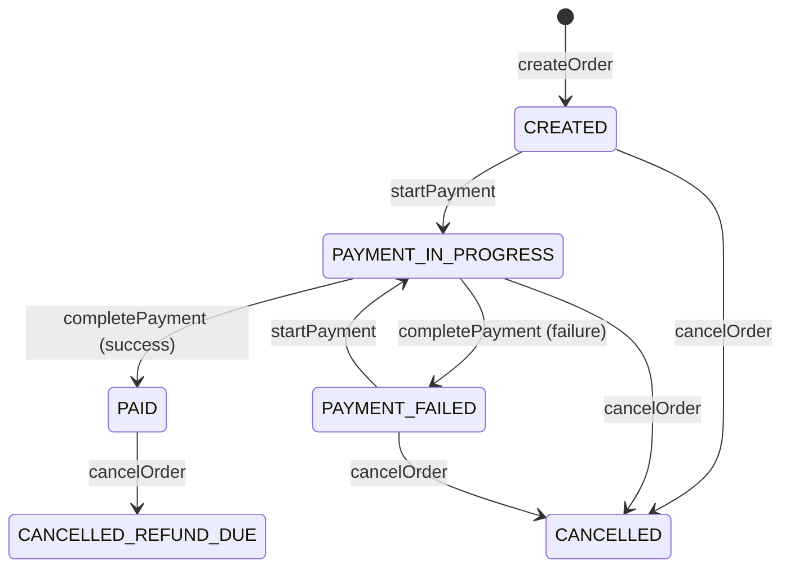

# Design Order Checkout and Payment for E-commerce Website in Java

#### Problem Statement
[https://codezym.com/question/134-design-order-checkout-payment](https://codezym.com/question/134-design-order-checkout-payment)

Every order in this problem is a small **state machine**. It starts as `CREATED`. Then it moves to `PAYMENT_IN_PROGRESS`, and after that to `PAID` or `PAYMENT_FAILED`. It can also be cancelled from most statuses.

What `startPayment`, `completePayment` and `cancelOrder` do depends on the current status of the order. This is exactly what the **State design pattern** is made for. We create one small class per status. Each class decides which actions are allowed and which status comes next.

The State pattern alone is the best fit here. We do not need a combination of patterns. Besides it, we only need two simple collections: a `HashMap` to find orders by id and a `HashSet` to check payment methods.

We will first build a simple `if-else` solution. Then we will look at its problems and improve it with the State pattern.

## How an Order Moves Between Statuses

An order is always in one of 6 statuses. The diagram shows every allowed move.



Any move that is not in the diagram is rejected. Here is the same thing as a table. Each cell shows the new status after the action.

| Status | startPayment | completePayment | cancelOrder |
|---|---|---|---|
| `CREATED` | `PAYMENT_IN_PROGRESS` | not allowed | `CANCELLED` |
| `PAYMENT_IN_PROGRESS` | not allowed | `PAID` or `PAYMENT_FAILED` | `CANCELLED` |
| `PAYMENT_FAILED` | `PAYMENT_IN_PROGRESS` | not allowed | `CANCELLED` |
| `PAID` | not allowed | not allowed | `CANCELLED_REFUND_DUE` |
| `CANCELLED` | not allowed | not allowed | not allowed |
| `CANCELLED_REFUND_DUE` | not allowed | not allowed | not allowed |

When an action is not allowed, each method returns its own answer:

- `startPayment` returns `ORDER_NOT_PAYABLE`
- `completePayment` returns `PAYMENT_NOT_IN_PROGRESS`
- `cancelOrder` returns `ORDER_ALREADY_CANCELLED`

This table is the heart of both solutions.

### Rules that are easy to miss

- Checks must run in the exact order given in the problem. In `startPayment`, the payment method is checked **before** the status. So a `PAID` order with an unsupported method returns `UNSUPPORTED_PAYMENT_METHOD`.
- In `createOrder`, a duplicate id is checked before the amount. So `createOrder("ORD-600", 0)` on an existing order returns `ORDER_ALREADY_EXISTS`.
- A failed payment keeps the payment method. The given payment reference is not saved, so it stays `NONE`.
- Cancelling never changes the payment method or the payment reference.
- Orders are never deleted. A cancelled order still exists, so creating it again returns `ORDER_ALREADY_EXISTS`.
- If a check fails, the order does not change at all.

## Data Structures We Need

- **`Map<String, Order> orders`**: finds an order by its id in O(1). Every method starts with this lookup.
- **`Set<String> supportedPaymentMethods`**: duplicate methods in the input collapse into one. Checking if a method is supported takes O(1).
- **`Order` class**: keeps the 7 fields that `getOrderDetails` prints.

We store the text `"NONE"` in empty fields instead of `null`. So printing the details needs no special checks.

## Solution 1: Simple Approach with if-else

### Idea

Keep the status of each order in an `enum`. Each method finds the order, runs its checks in the given order, and then updates the fields.

All the rules come straight from the table above.

### Code

```java
import java.util.*;

/**
 * Entry point of the checkout system.
 * Every method checks the order status with if-else and then updates the order.
 */
public class ECommerceCheckout {
    // orderId -> order, for O(1) lookups
    Map<String, Order> orders = new HashMap<>();
    // a set drops duplicate methods and answers "is it supported?" in O(1)
    Set<String> supportedPaymentMethods = new HashSet<>();

    public ECommerceCheckout(List<String> supportedPaymentMethods) {
        this.supportedPaymentMethods.addAll(supportedPaymentMethods);
    }

    public String createOrder(String orderId, int totalAmount) {
        if (orders.containsKey(orderId)) {
            return "ORDER_ALREADY_EXISTS";
        }
        if (totalAmount <= 0) {
            return "INVALID_AMOUNT";
        }
        orders.put(orderId, new Order(orderId, totalAmount));
        return "ORDER_CREATED";
    }

    public String startPayment(String orderId, String paymentMethod) {
        Order order = orders.get(orderId);
        if (order == null) {
            return "ORDER_NOT_FOUND";
        }
        if (!supportedPaymentMethods.contains(paymentMethod)) {
            return "UNSUPPORTED_PAYMENT_METHOD";
        }
        // payment can start only from CREATED or after a failed attempt
        if (order.status != OrderStatus.CREATED && order.status != OrderStatus.PAYMENT_FAILED) {
            return "ORDER_NOT_PAYABLE";
        }
        order.status = OrderStatus.PAYMENT_IN_PROGRESS;
        order.paymentMethod = paymentMethod;
        order.paymentReference = "NONE";
        return "PAYMENT_STARTED";
    }

    public String completePayment(String orderId, String paymentReference, boolean paymentSucceeded) {
        Order order = orders.get(orderId);
        if (order == null) {
            return "ORDER_NOT_FOUND";
        }
        if (order.status != OrderStatus.PAYMENT_IN_PROGRESS) {
            return "PAYMENT_NOT_IN_PROGRESS";
        }
        if (paymentSucceeded) {
            order.status = OrderStatus.PAID;
            order.paymentReference = paymentReference;
            return "PAYMENT_COMPLETED";
        }
        // the payment method stays as it is after a failure
        order.status = OrderStatus.PAYMENT_FAILED;
        order.paymentReference = "NONE";
        return "PAYMENT_FAILED";
    }

    public String cancelOrder(String orderId, String reason) {
        Order order = orders.get(orderId);
        if (order == null) {
            return "ORDER_NOT_FOUND";
        }
        if (order.status == OrderStatus.CANCELLED || order.status == OrderStatus.CANCELLED_REFUND_DUE) {
            return "ORDER_ALREADY_CANCELLED";
        }
        order.cancelReason = reason;
        if (order.status == OrderStatus.PAID) {
            order.status = OrderStatus.CANCELLED_REFUND_DUE;
            order.refundRequired = true;
            return "ORDER_CANCELLED_WITH_REFUND";
        }
        // CREATED, PAYMENT_IN_PROGRESS or PAYMENT_FAILED
        order.status = OrderStatus.CANCELLED;
        return "ORDER_CANCELLED";
    }

    public List<String> getOrderDetails(String orderId) {
        Order order = orders.get(orderId);
        if (order == null) {
            return new ArrayList<>(List.of("ORDER_NOT_FOUND"));
        }
        return order.getDetails();
    }
}

/** All the statuses an order can be in. */
enum OrderStatus {
    CREATED,
    PAYMENT_IN_PROGRESS,
    PAID,
    PAYMENT_FAILED,
    CANCELLED,
    CANCELLED_REFUND_DUE
}

/** Plain data holder for one order. */
class Order {
    String orderId;
    int totalAmount;
    OrderStatus status = OrderStatus.CREATED;
    String paymentMethod = "NONE";
    String paymentReference = "NONE";
    boolean refundRequired = false;
    String cancelReason = "NONE";

    Order(String orderId, int totalAmount) {
        this.orderId = orderId;
        this.totalAmount = totalAmount;
    }

    /** The 7 detail lines, in the exact order the problem asks for. */
    List<String> getDetails() {
        List<String> details = new ArrayList<>();
        details.add("ORDER:" + orderId);
        details.add("AMOUNT:" + totalAmount);
        details.add("STATUS:" + status);
        details.add("PAYMENT_METHOD:" + paymentMethod);
        details.add("PAYMENT_REF:" + paymentReference);
        details.add("REFUND_REQUIRED:" + refundRequired);
        details.add("CANCEL_REASON:" + cancelReason);
        return details;
    }
}
```

### Problems with this approach

This solution is correct. But it gets harder to work with as the system grows.

- The rules of one status are spread across many methods. To know what a `PAID` order can do, you have to read every method.
- Adding a new status, like `SHIPPED`, means editing every method. Missing one check gives a silent bug.
- Conditions like `status != CREATED && status != PAYMENT_FAILED` keep growing with each new status.

The problem itself says that an order moves through well-defined states. That is a strong hint to use the State pattern.

## Solution 2: State Design Pattern

### What is the State pattern?

In the State pattern, an object changes its behavior when its state changes.

Each state gets its own class. The object keeps its current state and forwards every action to it.

Look at the table again. Each row becomes one class. The allowed actions in that row become its methods. The "not allowed" cells are handled by default answers in a base class.

### Why State is the right pattern here

- Whether an action is allowed, and what happens next, depends on the current status.
- The statuses and the moves between them are fixed and clear.
- All rules of one status live in one small class. Read the class and you know that status completely.
- A new status means a new class. Old classes change only if they can move into the new status.

### Patterns that look good but do not fit

**Strategy for payment methods.** It is tempting to create `CardPayment`, `UpiPayment` and `WalletPayment` classes. But here all payment methods behave the same. We only check if a method is supported. The methods also arrive as plain strings at runtime, so we cannot write a class for each one in advance. A `HashSet` of strings is enough.

**Observer for refunds.** When a paid order is cancelled, we could notify a refund service using Observer. But refund processing is out of scope. We only keep a `true` or `false` flag. There is nobody to notify.

### Classes and their jobs

- **`ECommerceCheckout`**: the entry point. It finds the order and runs the checks that are the same for every status. Does the order exist? Is the payment method supported? Then it hands the action to the order.
- **`Order`**: holds the data and the current state. It decides nothing. It simply asks its current state.
- **`OrderState`**: the base class. It has one method per action. By default, each method returns its "not allowed" answer. Each state also returns its status name, which `getOrderDetails` prints.
- **One class per status**: each one overrides only the actions it allows. `CancelledState` and `CancelledRefundDueState` override no action, so every action is rejected.

A few small decisions:

- **Why is the payment method check outside the states?** The problem wants it before the status check. It is also the same for every status. So `ECommerceCheckout` does it first.
- **Why `new PaidState()` on every move?** State classes hold no data. We could share one object per state. But creating a tiny object is cheap and keeps the code simple.
- **Why are `CreatedState` and `PaymentFailedState` so alike?** Both allow the same actions. They differ only in the status name. We keep both so that each status has its own class.

### One call, step by step

Let us trace `cancelOrder("ORD-300", "CUSTOMER_CHANGED_MIND")` from Example 3. The order is `PAID` at this point.

1. `ECommerceCheckout` finds the order in the map.
2. It calls `order.cancel(reason)`.
3. The current state is `PaidState`, so `PaidState.cancel()` runs.
4. It saves the reason, sets `refundRequired` to `true` and moves the order to `CancelledRefundDueState`.
5. It returns `ORDER_CANCELLED_WITH_REFUND`.

If we cancel again, the current state is `CancelledRefundDueState`. It does not override `cancel()`. So the default answer `ORDER_ALREADY_CANCELLED` comes back.

### Code

```java
import java.util.*;

/**
 * Entry point of the checkout system.
 * It runs the checks that are the same for every status,
 * then hands the action to the order, which asks its current state.
 */
public class ECommerceCheckout {
    // orderId -> order, for O(1) lookups
    Map<String, Order> orders = new HashMap<>();
    // a set drops duplicate methods and answers "is it supported?" in O(1)
    Set<String> supportedPaymentMethods = new HashSet<>();

    public ECommerceCheckout(List<String> supportedPaymentMethods) {
        this.supportedPaymentMethods.addAll(supportedPaymentMethods);
    }

    public String createOrder(String orderId, int totalAmount) {
        if (orders.containsKey(orderId)) {
            return "ORDER_ALREADY_EXISTS";
        }
        if (totalAmount <= 0) {
            return "INVALID_AMOUNT";
        }
        orders.put(orderId, new Order(orderId, totalAmount));
        return "ORDER_CREATED";
    }

    public String startPayment(String orderId, String paymentMethod) {
        Order order = orders.get(orderId);
        if (order == null) {
            return "ORDER_NOT_FOUND";
        }
        // must run before the status check, so it stays here
        if (!supportedPaymentMethods.contains(paymentMethod)) {
            return "UNSUPPORTED_PAYMENT_METHOD";
        }
        return order.startPayment(paymentMethod);
    }

    public String completePayment(String orderId, String paymentReference, boolean paymentSucceeded) {
        Order order = orders.get(orderId);
        if (order == null) {
            return "ORDER_NOT_FOUND";
        }
        return order.completePayment(paymentReference, paymentSucceeded);
    }

    public String cancelOrder(String orderId, String reason) {
        Order order = orders.get(orderId);
        if (order == null) {
            return "ORDER_NOT_FOUND";
        }
        return order.cancel(reason);
    }

    public List<String> getOrderDetails(String orderId) {
        Order order = orders.get(orderId);
        if (order == null) {
            return new ArrayList<>(List.of("ORDER_NOT_FOUND"));
        }
        return order.getDetails();
    }
}

/**
 * Holds the data of one order and its current state.
 * The order does not decide anything itself.
 * It forwards every action to its current state.
 */
class Order {
    String orderId;
    int totalAmount;
    OrderState state = new CreatedState();
    String paymentMethod = "NONE";
    String paymentReference = "NONE";
    boolean refundRequired = false;
    String cancelReason = "NONE";

    Order(String orderId, int totalAmount) {
        this.orderId = orderId;
        this.totalAmount = totalAmount;
    }

    String startPayment(String paymentMethod) {
        return state.startPayment(this, paymentMethod);
    }

    String completePayment(String paymentReference, boolean paymentSucceeded) {
        return state.completePayment(this, paymentReference, paymentSucceeded);
    }

    String cancel(String reason) {
        return state.cancel(this, reason);
    }

    /** The 7 detail lines, in the exact order the problem asks for. */
    List<String> getDetails() {
        List<String> details = new ArrayList<>();
        details.add("ORDER:" + orderId);
        details.add("AMOUNT:" + totalAmount);
        details.add("STATUS:" + state.getName());
        details.add("PAYMENT_METHOD:" + paymentMethod);
        details.add("PAYMENT_REF:" + paymentReference);
        details.add("REFUND_REQUIRED:" + refundRequired);
        details.add("CANCEL_REASON:" + cancelReason);
        return details;
    }
}

/**
 * Base class for every order status.
 * Each action returns its "not allowed" answer by default.
 * A status class overrides only the actions it allows.
 */
abstract class OrderState {
    /** Status name shown in the order details, like "PAID". */
    abstract String getName();

    String startPayment(Order order, String paymentMethod) {
        return "ORDER_NOT_PAYABLE";
    }

    String completePayment(Order order, String paymentReference, boolean paymentSucceeded) {
        return "PAYMENT_NOT_IN_PROGRESS";
    }

    String cancel(Order order, String reason) {
        return "ORDER_ALREADY_CANCELLED";
    }
}

/** CREATED: the order exists, payment has not started yet. */
class CreatedState extends OrderState {
    @Override
    String getName() {
        return "CREATED";
    }

    @Override
    String startPayment(Order order, String paymentMethod) {
        order.paymentMethod = paymentMethod;
        order.paymentReference = "NONE";
        order.state = new PaymentInProgressState();
        return "PAYMENT_STARTED";
    }

    @Override
    String cancel(Order order, String reason) {
        order.cancelReason = reason;
        order.state = new CancelledState();
        return "ORDER_CANCELLED";
    }
}

/** PAYMENT_IN_PROGRESS: waiting for the payment result. */
class PaymentInProgressState extends OrderState {
    @Override
    String getName() {
        return "PAYMENT_IN_PROGRESS";
    }

    @Override
    String completePayment(Order order, String paymentReference, boolean paymentSucceeded) {
        if (paymentSucceeded) {
            order.paymentReference = paymentReference;
            order.state = new PaidState();
            return "PAYMENT_COMPLETED";
        }
        // the payment method stays as it is after a failure
        order.paymentReference = "NONE";
        order.state = new PaymentFailedState();
        return "PAYMENT_FAILED";
    }

    @Override
    String cancel(Order order, String reason) {
        order.cancelReason = reason;
        order.state = new CancelledState();
        return "ORDER_CANCELLED";
    }
}

/** PAYMENT_FAILED: the last attempt failed. Payment can be started again. */
class PaymentFailedState extends OrderState {
    @Override
    String getName() {
        return "PAYMENT_FAILED";
    }

    @Override
    String startPayment(Order order, String paymentMethod) {
        order.paymentMethod = paymentMethod;
        order.paymentReference = "NONE";
        order.state = new PaymentInProgressState();
        return "PAYMENT_STARTED";
    }

    @Override
    String cancel(Order order, String reason) {
        order.cancelReason = reason;
        order.state = new CancelledState();
        return "ORDER_CANCELLED";
    }
}

/** PAID: money received. Cancelling now means a refund is due. */
class PaidState extends OrderState {
    @Override
    String getName() {
        return "PAID";
    }

    @Override
    String cancel(Order order, String reason) {
        order.cancelReason = reason;
        order.refundRequired = true;
        order.state = new CancelledRefundDueState();
        return "ORDER_CANCELLED_WITH_REFUND";
    }
}

/** CANCELLED: final state. The default answers reject every action. */
class CancelledState extends OrderState {
    @Override
    String getName() {
        return "CANCELLED";
    }
}

/** CANCELLED_REFUND_DUE: final state. The default answers reject every action. */
class CancelledRefundDueState extends OrderState {
    @Override
    String getName() {
        return "CANCELLED_REFUND_DUE";
    }
}
```

## Complexity

- **Time:** O(1) on average for every method. Each call does one map lookup and a fixed amount of work. `getOrderDetails` always builds exactly 7 lines.
- **Space:** O(n + m), where n is the number of orders and m is the number of supported payment methods.