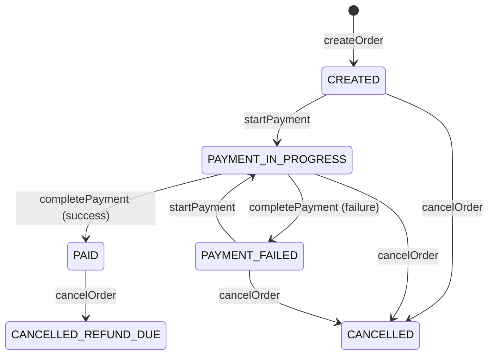

# Design Order Checkout and Payment for E-commerce Website in Python

#### Problem Statement
[https://codezym.com/question/134-design-order-checkout-payment](https://codezym.com/question/134-design-order-checkout-payment)

Every order in this problem is a small **state machine**. It starts as `CREATED`. Then it moves to `PAYMENT_IN_PROGRESS`, and after that to `PAID` or `PAYMENT_FAILED`. It can also be cancelled from most statuses.

What `startPayment`, `completePayment` and `cancelOrder` do depends on the current status of the order. This is exactly what the **State design pattern** is made for. We create one small class per status. Each class decides which actions are allowed and which status comes next.

The State pattern alone is the best fit here. We do not need a combination of patterns. Besides it, we only need two simple collections: a `dict` to find orders by id and a `set` to check payment methods.

We will first build a simple `if-else` solution. Then we will look at its problems and improve it with the State pattern.

## How an Order Moves Between Statuses

An order is always in one of 6 statuses. The diagram shows every allowed move.



Any move that is not in the diagram is rejected. Here is the same thing as a table. Each cell shows the new status after the action.

| Status | startPayment | completePayment | cancelOrder |
|---|---|---|---|
| `CREATED` | `PAYMENT_IN_PROGRESS` | not allowed | `CANCELLED` |
| `PAYMENT_IN_PROGRESS` | not allowed | `PAID` or `PAYMENT_FAILED` | `CANCELLED` |
| `PAYMENT_FAILED` | `PAYMENT_IN_PROGRESS` | not allowed | `CANCELLED` |
| `PAID` | not allowed | not allowed | `CANCELLED_REFUND_DUE` |
| `CANCELLED` | not allowed | not allowed | not allowed |
| `CANCELLED_REFUND_DUE` | not allowed | not allowed | not allowed |

When an action is not allowed, each method returns its own answer:

- `startPayment` returns `ORDER_NOT_PAYABLE`
- `completePayment` returns `PAYMENT_NOT_IN_PROGRESS`
- `cancelOrder` returns `ORDER_ALREADY_CANCELLED`

This table is the heart of both solutions.

### Rules that are easy to miss

- Checks must run in the exact order given in the problem. In `startPayment`, the payment method is checked **before** the status. So a `PAID` order with an unsupported method returns `UNSUPPORTED_PAYMENT_METHOD`.
- In `createOrder`, a duplicate id is checked before the amount. So `createOrder("ORD-600", 0)` on an existing order returns `ORDER_ALREADY_EXISTS`.
- A failed payment keeps the payment method. The given payment reference is not saved, so it stays `NONE`.
- Cancelling never changes the payment method or the payment reference.
- Orders are never deleted. A cancelled order still exists, so creating it again returns `ORDER_ALREADY_EXISTS`.
- If a check fails, the order does not change at all.
- Python prints booleans as `True` and `False`. The problem wants `true` and `false`. So we print the flag with `str(flag).lower()`.

## Data Structures We Need

- **`orders` dict**: maps order id to `Order`. It finds an order in O(1). Every method starts with this lookup.
- **`supported_payment_methods` set**: duplicate methods in the input collapse into one. Checking if a method is supported takes O(1).
- **`Order` class**: keeps the 7 fields that `getOrderDetails` prints.

We store the text `"NONE"` in empty fields instead of `None`. So printing the details needs no special checks.

## Solution 1: Simple Approach with if-else

### Idea

Keep the status of each order as a plain string, like `"CREATED"`. Each method finds the order, runs its checks in the given order, and then updates the fields.

All the rules come straight from the table above.

### Code

```python
class ECommerceCheckout:
    """Entry point of the checkout system.

    Every method checks the order status with if-else,
    then updates the order.
    """

    def __init__(self, supportedPaymentMethods):
        # a set drops duplicate methods and answers "is it supported?" in O(1)
        self.supported_payment_methods = set(supportedPaymentMethods)
        # order_id -> Order, for O(1) lookups
        self.orders = {}

    def createOrder(self, orderId, totalAmount):
        if orderId in self.orders:
            return "ORDER_ALREADY_EXISTS"
        if totalAmount <= 0:
            return "INVALID_AMOUNT"
        self.orders[orderId] = Order(orderId, totalAmount)
        return "ORDER_CREATED"

    def startPayment(self, orderId, paymentMethod):
        order = self.orders.get(orderId)
        if order is None:
            return "ORDER_NOT_FOUND"
        if paymentMethod not in self.supported_payment_methods:
            return "UNSUPPORTED_PAYMENT_METHOD"
        # payment can start only from CREATED or after a failed attempt
        if order.status not in ("CREATED", "PAYMENT_FAILED"):
            return "ORDER_NOT_PAYABLE"
        order.status = "PAYMENT_IN_PROGRESS"
        order.payment_method = paymentMethod
        order.payment_reference = "NONE"
        return "PAYMENT_STARTED"

    def completePayment(self, orderId, paymentReference, paymentSucceeded):
        order = self.orders.get(orderId)
        if order is None:
            return "ORDER_NOT_FOUND"
        if order.status != "PAYMENT_IN_PROGRESS":
            return "PAYMENT_NOT_IN_PROGRESS"
        if paymentSucceeded:
            order.status = "PAID"
            order.payment_reference = paymentReference
            return "PAYMENT_COMPLETED"
        # the payment method stays as it is after a failure
        order.status = "PAYMENT_FAILED"
        order.payment_reference = "NONE"
        return "PAYMENT_FAILED"

    def cancelOrder(self, orderId, reason):
        order = self.orders.get(orderId)
        if order is None:
            return "ORDER_NOT_FOUND"
        if order.status in ("CANCELLED", "CANCELLED_REFUND_DUE"):
            return "ORDER_ALREADY_CANCELLED"
        order.cancel_reason = reason
        if order.status == "PAID":
            order.status = "CANCELLED_REFUND_DUE"
            order.refund_required = True
            return "ORDER_CANCELLED_WITH_REFUND"
        # CREATED, PAYMENT_IN_PROGRESS or PAYMENT_FAILED
        order.status = "CANCELLED"
        return "ORDER_CANCELLED"

    def getOrderDetails(self, orderId):
        order = self.orders.get(orderId)
        if order is None:
            return ["ORDER_NOT_FOUND"]
        return order.get_details()


class Order:
    """Plain data holder for one order."""

    def __init__(self, order_id, total_amount):
        self.order_id = order_id
        self.total_amount = total_amount
        self.status = "CREATED"
        self.payment_method = "NONE"
        self.payment_reference = "NONE"
        self.refund_required = False
        self.cancel_reason = "NONE"

    def get_details(self):
        """The 7 detail lines, in the exact order the problem asks for."""
        return [
            f"ORDER:{self.order_id}",
            f"AMOUNT:{self.total_amount}",
            f"STATUS:{self.status}",
            f"PAYMENT_METHOD:{self.payment_method}",
            f"PAYMENT_REF:{self.payment_reference}",
            # Python prints True/False, but the problem wants true/false
            f"REFUND_REQUIRED:{str(self.refund_required).lower()}",
            f"CANCEL_REASON:{self.cancel_reason}",
        ]
```

### Problems with this approach

This solution is correct. But it gets harder to work with as the system grows.

- The rules of one status are spread across many methods. To know what a `PAID` order can do, you have to read every method.
- Adding a new status, like `SHIPPED`, means editing every method. Missing one check gives a silent bug.
- Conditions like `order.status not in ("CREATED", "PAYMENT_FAILED")` keep growing with each new status.
- A typo in a status string, like `"CANCELED"`, raises no error. It just gives wrong answers.

The problem itself says that an order moves through well-defined states. That is a strong hint to use the State pattern.

## Solution 2: State Design Pattern

### What is the State pattern?

In the State pattern, an object changes its behavior when its state changes.

Each state gets its own class. The object keeps its current state and forwards every action to it.

Look at the table again. Each row becomes one class. The allowed actions in that row become its methods. The "not allowed" cells are handled by default answers in a base class.

### Why State is the right pattern here

- Whether an action is allowed, and what happens next, depends on the current status.
- The statuses and the moves between them are fixed and clear.
- All rules of one status live in one small class. Read the class and you know that status completely.
- A new status means a new class. Old classes change only if they can move into the new status.

### Patterns that look good but do not fit

**Strategy for payment methods.** It is tempting to create `CardPayment`, `UpiPayment` and `WalletPayment` classes. But here all payment methods behave the same. We only check if a method is supported. The methods also arrive as plain strings at runtime, so we cannot write a class for each one in advance. A `set` of strings is enough.

**Observer for refunds.** When a paid order is cancelled, we could notify a refund service using Observer. But refund processing is out of scope. We only keep a `True` or `False` flag. There is nobody to notify.

### Classes and their jobs

- **`ECommerceCheckout`**: the entry point. It finds the order and runs the checks that are the same for every status. Does the order exist? Is the payment method supported? Then it hands the action to the order.
- **`Order`**: holds the data and the current state. It decides nothing. It simply asks its current state.
- **`OrderState`**: the base class. It has one method per action. By default, each method returns its "not allowed" answer. Each state also has a `name`, which `getOrderDetails` prints.
- **One class per status**: each one overrides only the actions it allows. `CancelledState` and `CancelledRefundDueState` override no action, so every action is rejected.

A few small decisions:

- **Why is the payment method check outside the states?** The problem wants it before the status check. It is also the same for every status. So `ECommerceCheckout` does it first.
- **Why `PaidState()` on every move?** State classes hold no data. We could share one object per state. But creating a tiny object is cheap and keeps the code simple.
- **Why are `CreatedState` and `PaymentFailedState` so alike?** Both allow the same actions. They differ only in the status name. We keep both so that each status has its own class.

### One call, step by step

Let us trace `cancelOrder("ORD-300", "CUSTOMER_CHANGED_MIND")` from Example 3. The order is `PAID` at this point.

1. `ECommerceCheckout` finds the order in the dict.
2. It calls `order.cancel(reason)`.
3. The current state is `PaidState`, so `PaidState.cancel()` runs.
4. It saves the reason, sets `refund_required` to `True` and moves the order to `CancelledRefundDueState`.
5. It returns `ORDER_CANCELLED_WITH_REFUND`.

If we cancel again, the current state is `CancelledRefundDueState`. It does not override `cancel()`. So the default answer `ORDER_ALREADY_CANCELLED` comes back.

### Code

```python
class ECommerceCheckout:
    """Entry point of the checkout system.

    It runs the checks that are the same for every status,
    then hands the action to the order, which asks its current state.
    """

    def __init__(self, supportedPaymentMethods):
        # a set drops duplicate methods and answers "is it supported?" in O(1)
        self.supported_payment_methods = set(supportedPaymentMethods)
        # order_id -> Order, for O(1) lookups
        self.orders = {}

    def createOrder(self, orderId, totalAmount):
        if orderId in self.orders:
            return "ORDER_ALREADY_EXISTS"
        if totalAmount <= 0:
            return "INVALID_AMOUNT"
        self.orders[orderId] = Order(orderId, totalAmount)
        return "ORDER_CREATED"

    def startPayment(self, orderId, paymentMethod):
        order = self.orders.get(orderId)
        if order is None:
            return "ORDER_NOT_FOUND"
        # must run before the status check, so it stays here
        if paymentMethod not in self.supported_payment_methods:
            return "UNSUPPORTED_PAYMENT_METHOD"
        return order.start_payment(paymentMethod)

    def completePayment(self, orderId, paymentReference, paymentSucceeded):
        order = self.orders.get(orderId)
        if order is None:
            return "ORDER_NOT_FOUND"
        return order.complete_payment(paymentReference, paymentSucceeded)

    def cancelOrder(self, orderId, reason):
        order = self.orders.get(orderId)
        if order is None:
            return "ORDER_NOT_FOUND"
        return order.cancel(reason)

    def getOrderDetails(self, orderId):
        order = self.orders.get(orderId)
        if order is None:
            return ["ORDER_NOT_FOUND"]
        return order.get_details()


class Order:
    """Holds the data of one order and its current state.

    The order does not decide anything itself.
    It forwards every action to its current state.
    """

    def __init__(self, order_id, total_amount):
        self.order_id = order_id
        self.total_amount = total_amount
        self.state = CreatedState()
        self.payment_method = "NONE"
        self.payment_reference = "NONE"
        self.refund_required = False
        self.cancel_reason = "NONE"

    def start_payment(self, payment_method):
        return self.state.start_payment(self, payment_method)

    def complete_payment(self, payment_reference, payment_succeeded):
        return self.state.complete_payment(
            self, payment_reference, payment_succeeded)

    def cancel(self, reason):
        return self.state.cancel(self, reason)

    def get_details(self):
        """The 7 detail lines, in the exact order the problem asks for."""
        return [
            f"ORDER:{self.order_id}",
            f"AMOUNT:{self.total_amount}",
            f"STATUS:{self.state.name}",
            f"PAYMENT_METHOD:{self.payment_method}",
            f"PAYMENT_REF:{self.payment_reference}",
            # Python prints True/False, but the problem wants true/false
            f"REFUND_REQUIRED:{str(self.refund_required).lower()}",
            f"CANCEL_REASON:{self.cancel_reason}",
        ]


class OrderState:
    """Base class for every order status.

    Each action returns its "not allowed" answer by default.
    A status class overrides only the actions it allows.
    """

    # status name shown in the order details, like "PAID"
    name = ""

    def start_payment(self, order, payment_method):
        return "ORDER_NOT_PAYABLE"

    def complete_payment(self, order, payment_reference, payment_succeeded):
        return "PAYMENT_NOT_IN_PROGRESS"

    def cancel(self, order, reason):
        return "ORDER_ALREADY_CANCELLED"


class CreatedState(OrderState):
    """CREATED: the order exists, payment has not started yet."""

    name = "CREATED"

    def start_payment(self, order, payment_method):
        order.payment_method = payment_method
        order.payment_reference = "NONE"
        order.state = PaymentInProgressState()
        return "PAYMENT_STARTED"

    def cancel(self, order, reason):
        order.cancel_reason = reason
        order.state = CancelledState()
        return "ORDER_CANCELLED"


class PaymentInProgressState(OrderState):
    """PAYMENT_IN_PROGRESS: waiting for the payment result."""

    name = "PAYMENT_IN_PROGRESS"

    def complete_payment(self, order, payment_reference, payment_succeeded):
        if payment_succeeded:
            order.payment_reference = payment_reference
            order.state = PaidState()
            return "PAYMENT_COMPLETED"
        # the payment method stays as it is after a failure
        order.payment_reference = "NONE"
        order.state = PaymentFailedState()
        return "PAYMENT_FAILED"

    def cancel(self, order, reason):
        order.cancel_reason = reason
        order.state = CancelledState()
        return "ORDER_CANCELLED"


class PaymentFailedState(OrderState):
    """PAYMENT_FAILED: the last attempt failed. Payment can start again."""

    name = "PAYMENT_FAILED"

    def start_payment(self, order, payment_method):
        order.payment_method = payment_method
        order.payment_reference = "NONE"
        order.state = PaymentInProgressState()
        return "PAYMENT_STARTED"

    def cancel(self, order, reason):
        order.cancel_reason = reason
        order.state = CancelledState()
        return "ORDER_CANCELLED"


class PaidState(OrderState):
    """PAID: money received. Cancelling now means a refund is due."""

    name = "PAID"

    def cancel(self, order, reason):
        order.cancel_reason = reason
        order.refund_required = True
        order.state = CancelledRefundDueState()
        return "ORDER_CANCELLED_WITH_REFUND"


class CancelledState(OrderState):
    """CANCELLED: final state. Every action is rejected."""

    name = "CANCELLED"


class CancelledRefundDueState(OrderState):
    """CANCELLED_REFUND_DUE: final state. Every action is rejected."""

    name = "CANCELLED_REFUND_DUE"
```

## Complexity

- **Time:** O(1) on average for every method. Each call does one dict lookup and a fixed amount of work. `getOrderDetails` always builds exactly 7 lines.
- **Space:** O(n + m), where n is the number of orders and m is the number of supported payment methods.