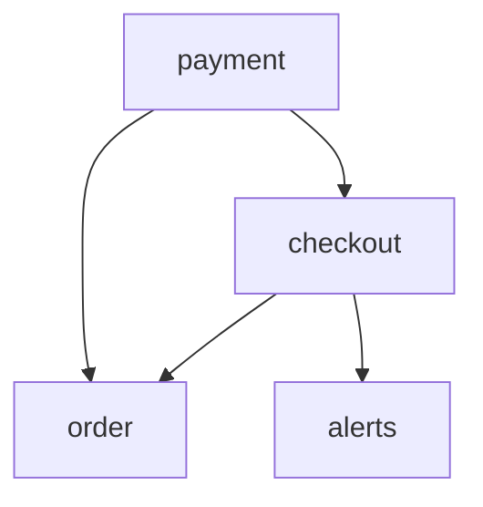

# Design Service Dependency Impact Analyzer in Python

#### Problem Statement

[https://codezym.com/question/266-service-dependency-impact-analyzer](https://codezym.com/question/266-service-dependency-impact-analyzer)

Store, for each service, the services that depend on it. When a service fails, use breadth-first search, or BFS, to follow the failure one level at a time. This gives the smallest impact depth for every affected service. For cycle detection, repeatedly remove services with no remaining dependencies. Both operations use maps, sets, and a queue.

## 1. Start with a simple scan

The entry `"order,payment"` means that `order` needs `payment`. To find what a payment failure affects, look for entries whose second name is `payment`.

A simple BFS can scan the entire dependency list whenever it removes a service from its queue. Its inner step looks like this:

```python
for entry in dependencies:
    service, dependency = entry.split(",", 1)

    if dependency == current and service not in depth:
        depth[service] = depth[current] + 1
        queue.append(service)
```

This works, but it repeatedly scans unrelated dependencies. With `V` services and `E` dependency entries, the traversal can take `O(V * E)` time.

## 2. Build a map of dependents

Read the dependency list once. For each `"service,dependency"` entry, add `service` to the set stored under `dependency`.

For example, `"order,payment"` adds `order` to `dependents["payment"]`. We have reversed the input edge so it points in the direction a failure spreads.

Use a set for each group because duplicate dependency entries count only once. Initialize an empty set for every service, including isolated ones.

Now BFS reads only the dependents of the current service.

## 3. Find the minimum impact depths

Start with the failed service at depth `0` and put it in a queue. Whenever BFS discovers an unseen dependent, give it the current depth plus `1` and add it to the queue.

The depth map also records which services have been visited. Mark a service when adding it to the queue, so it is queued only once.

BFS processes all services at depth `1` before depth `2`, and so on. Therefore, the first visit gives the shortest path, even when another route is longer.

Marking the failed service before traversal also prevents a cycle from adding it again. Remove it from the returned list, then sort the other services by numeric depth and service name.

`getImpactDepth` takes the largest value in the depth map. This is the greatest **minimum** depth, not the longest possible path. When nothing else is affected, the map contains only the failed service at depth `0`.

### A small example

```text
services = ["payment", "checkout", "order", "alerts", "audit"]

dependencies = [
    "checkout,payment",
    "order,checkout",
    "order,payment",
    "alerts,checkout",
    "order,payment"
]

failedService = "payment"
```

The arrows below show how a failure spreads:



Both `checkout` and `order` have depth `1`. Although `order` can also be reached through `checkout`, its direct route is shorter. `alerts` has depth `2`. The duplicate entry changes nothing, and `audit` is unaffected.

```text
getImpactedServices: ["checkout,1", "order,1", "alerts,2"]
getImpactDepth: 2
hasCyclicDependency: false
```

## 4. Detect cycles across the whole graph

Use **Kahn's algorithm**, a queue-based method for topological sorting. The same reversed graph works because reversing every edge preserves whether a directed cycle exists.

Count the incoming edges for each service in the reversed graph. This count, called its `in_degree`, is the number of dependencies it still has.

1. Queue every service whose count is `0`, across all connected and disconnected groups.
2. Remove one queued service and increase the processed count.
3. Decrease the count of each of its dependents. Queue a dependent when its count becomes `0`.
4. If fewer than `V` services were processed, return `true`.

Why does this work? In an acyclic graph, every nonempty remaining part has a service with no remaining dependencies. A cycle cannot be fully removed because each member still needs another member. Services outside the cycle may also remain blocked, but any unprocessed services prove that a cycle exists.

Count edges from the sets built earlier so duplicates cannot inflate the counts. This method is iterative, so a long chain does not risk a recursion stack overflow.

## Complexity

Let `V` be the number of services, `E` the number of input dependency entries, and `K` the number of impacted services.

- `getImpactedServices`: `O(V + E + K log K)` time, including result sorting.
- `getImpactDepth`: `O(V + E)` time. It does not sort anything.
- `hasCyclicDependency`: `O(V + E)` time.
- Each method uses `O(V + E)` extra space.

These bounds use average constant-time map and set operations and treat the bounded service-name length as constant.

## Complete Solution

`ServiceDependencyImpactAnalyzer` keeps the required public methods together. One helper builds the graph, and another shares the BFS logic between the two impact methods. Each call builds fresh data from its arguments and leaves the input lists unchanged.

```python
from collections import deque
from dataclasses import dataclass


@dataclass(eq=False)
class ServiceDependencyImpactAnalyzer:
    def getImpactedServices(self, services, dependencies, failedService):
        dependents = self.build_dependents(services, dependencies)
        depth = self.find_impact_depths(dependents, failedService)

        impacted = list(depth)
        impacted.remove(failedService)

        # Sort by numeric depth first, then by service name.
        impacted.sort(key=lambda service: (depth[service], service))
        return [f"{service},{depth[service]}" for service in impacted]

    def getImpactDepth(self, services, dependencies, failedService):
        dependents = self.build_dependents(services, dependencies)
        depth = self.find_impact_depths(dependents, failedService)
        return max(depth.values())

    def hasCyclicDependency(self, services, dependencies):
        dependents = self.build_dependents(services, dependencies)
        in_degree = {service: 0 for service in services}

        # Count incoming edges in the reversed graph, after deduplication.
        for next_services in dependents.values():
            for service in next_services:
                in_degree[service] += 1

        queue = deque(
            service for service in services if in_degree[service] == 0
        )
        removed_count = 0

        while queue:
            current = queue.popleft()
            removed_count += 1

            for next_service in dependents[current]:
                in_degree[next_service] -= 1
                if in_degree[next_service] == 0:
                    queue.append(next_service)

        return removed_count < len(services)

    def build_dependents(self, services, dependencies):
        dependents = {service: set() for service in services}

        for dependency in dependencies:
            service, required_service = dependency.split(",", 1)
            # "order,payment" becomes an impact edge from payment to order.
            dependents[required_service].add(service)

        return dependents

    def find_impact_depths(self, dependents, failed_service):
        # Mark the source before traversal so a cycle cannot add it again.
        depth = {failed_service: 0}
        queue = deque([failed_service])

        while queue:
            current = queue.popleft()
            for next_service in dependents[current]:
                if next_service not in depth:
                    depth[next_service] = depth[current] + 1
                    queue.append(next_service)

        return depth
```
