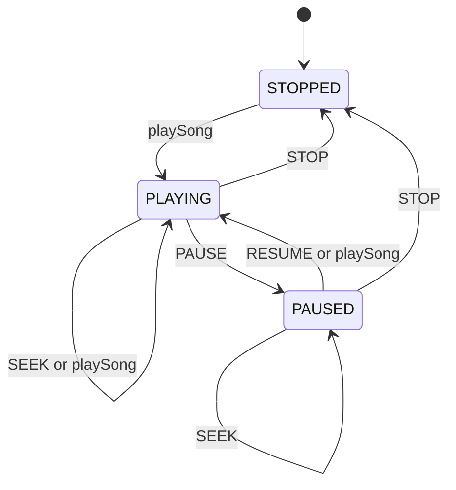

# Design Spotify Music Streaming in Java

#### Problem Statement
[https://codezym.com/question/268-spotify-music-streaming-and-search](https://codezym.com/question/268-spotify-music-streaming-and-search)

This problem has two separate parts. A **music catalogue** stores songs and answers searches. A **playback session** for each user remembers what that user is listening to.

The best fit is a mix of two design patterns. The **State pattern** runs playback, because what `PAUSE`, `RESUME`, `SEEK` and `STOP` do depends only on the current status: playing, paused or stopped. A thin **Facade**, `SpotifyMusicService`, hides the catalogue and the sessions behind one simple class.

The trickiest part is updating a song. Our answer: a session points to the **same `Song` object** that the catalogue holds, so new details show up everywhere for free. Only the duration is copied when the song starts.


## The Rules That Shape the Design

- Updating a song must not reset or recreate any session.
- A user playing an updated song sees the new title, artist and album, but keeps the old duration until the song is started again.
- Search is a case-insensitive substring match on title, artist and album (not on the song id). Results are sorted by `songId`.
- What a control action does depends on the current status.


## A Simple First Attempt

The quickest way is to put everything in one class with a few maps.

```java
// Everything lives inside one class
Map<String, String[]> songs = new HashMap<>();     // songId -> {title, artist, album, duration}
Map<String, String> status = new HashMap<>();      // userId -> PLAYING, PAUSED or STOPPED
Map<String, String> currentSong = new HashMap<>(); // userId -> songId or NO_SONG
Map<String, Integer> position = new HashMap<>();   // userId -> seconds
```

Search checks every song, lowercases its fields and then sorts the matches.

```java
public List<String> searchSongs(String query) {
    String q = query.toLowerCase();
    List<String> ids = new ArrayList<>();
    for (String id : songs.keySet()) {
        String[] s = songs.get(id);
        // lowercase every field again, on every search
        if (s[0].toLowerCase().contains(q) || s[1].toLowerCase().contains(q)
                || s[2].toLowerCase().contains(q)) {
            ids.add(id);
        }
    }
    Collections.sort(ids);   // sort the matches on every search
    List<String> result = new ArrayList<>();
    for (String id : ids) {
        String[] s = songs.get(id);
        result.add(id + "," + s[0] + "," + s[1] + "," + s[2] + "," + s[3]);
    }
    return result;
}
```

Playback control is a chain of `if-else` checks.

```java
public String controlPlayback(String userId, String action, int positionSeconds) {
    String current = status.get(userId);
    if (action.equals("PAUSE") && current.equals("PLAYING")) {
        status.put(userId, "PAUSED");
    } else if (action.equals("RESUME") && current.equals("PAUSED")) {
        status.put(userId, "PLAYING");
    } else if (action.equals("SEEK") && !current.equals("STOPPED")) {
        position.put(userId, positionSeconds);
    } else if (action.equals("STOP")) {
        // every map must be reset by hand
        status.put(userId, "STOPPED");
        currentSong.put(userId, "NO_SONG");
        position.put(userId, 0);
    }
    return status.get(userId) + "," + currentSong.get(userId) + "," + position.get(userId);
}
```

It works, but it has real problems.

- **Search repeats work.** Every search lowercases every field of every song, builds every output line again and sorts the matches.
- **One session is spread over three maps.** `STOP` must reset all of them, and the duration rule would need a fourth map. Missing one is an easy bug.
- **Status rules are tangled.** Each branch mixes "which action came" with "which status we are in". A new status, like `BUFFERING`, means touching many branches.
- **Catalogue and playback live in one class**, but the problem asks for separate components.


## The Better Solution

We fix these problems in four steps.

### Step 1: Split the work into small classes

| Class | Job |
|---|---|
| `Song` | One song and its details |
| `MusicCatalogue` | Stores all songs and runs search |
| `PlaybackSession` | One user's song, position and status |
| `PlaybackState` and its 3 states | What each action does in each status |
| `SpotifyMusicService` | The Facade the caller talks to |

`SpotifyMusicService` keeps a `Map<String, PlaybackSession>` with one session per user. Each session is its own object, so one user's playback can never change another user's.

The service only forwards each call to the right part. That is the Facade's whole job here.

### Step 2: Share the song, copy the duration

This one idea handles all the update rules.

`addOrUpdateSong` never replaces an existing `Song`. It **changes the same object in place**. A session keeps a reference to that same object, so a playing user sees the new title, artist and album right away. No extra code is needed.

The duration is different. It must stay fixed for the current session, so the session **copies** it when the song starts.

```java
void play(Song song) {
    // Shared object: the user sees later title, artist and album updates
    this.song = song;
    // Own copy: the duration never changes for this session
    this.durationSeconds = song.durationSeconds;
    this.positionSeconds = 0;
    this.state = new PlayingState();
}
```

Playing a song again makes a fresh copy. So a restart uses the new catalogue duration, just as the problem asks.

### Step 3: Make search cheaper

A query can match the middle of a word, like `oad` inside `Road`. A word index can't find that, so we still check every song. But we make each check cheap.

- **Prepare once, reuse many times.** `Song` builds its lowercase fields and its output line once, inside `update()`. A search only runs `contains` and adds ready-made strings.
- **Keep the songs sorted all the time.** `MusicCatalogue` combines a `HashMap` (fast lookup by id) with a `List` sorted by `songId`. A new song goes to the index found by a binary search. Updates never change an id, so the list stays sorted. Search walks the list in order, so the matches come out already sorted.

### Step 4: The State pattern for playback

Here is the state machine behind the control rules.



| Action | `StoppedState` | `PlayingState` | `PausedState` |
|---|---|---|---|
| `PAUSE` | no change | becomes paused | no change |
| `RESUME` | no change | no change | becomes playing |
| `SEEK` | no change | moves position | moves position |
| `STOP` | no change | clears session | clears session |

Each column of this table becomes one small class.

- `PlaybackState` is an interface whose `default` methods do nothing.
- Each state overrides only the actions it allows. `StoppedState` allows none, so it only returns its status name.
- `PlaybackSession` keeps the current state and hands every action to it.
- `playSong` works the same in every status, so it lives directly in `PlaybackSession`.

The problem promises that every action comes in a valid status. The "no change" defaults just keep the code safe, with no extra checks.

**Why not an enum and a `switch`?** With three statuses it would work. But all the rules would sit in one method that grows with every new status or action. With the State pattern, the rules of one status live in one small class. A new status like `BUFFERING` is just one new class.


## Patterns That Look Good but Don't Fit

**Observer.** "Users playing an updated song see its new details" sounds like the catalogue should notify every listening session. But each session already holds the same `Song` object, so it sees changes instantly. Observer would add subscribe and unsubscribe work on every play and stop, plus extra care to keep the copied duration untouched.

**Command.** We could wrap `PAUSE`, `RESUME`, `SEEK` and `STOP` in command objects. Commands shine when you need undo, a queue or a history of actions. Here each action runs once, right away, and its meaning depends on the status, which the State pattern already handles. Commands would only add classes.


## Complexity

`N` is the number of songs and `L` is the length of a text field (at most 100).

| Method | Time |
|---|---|
| `addOrUpdateSong` | O(L) for an update. A new song also needs O(log N) to find its index, plus a list shift that is O(N) in the worst case |
| `searchSongs` | O(N × L), one pass over the sorted list, no sorting |
| `playSong` | O(1) |
| `controlPlayback` | O(1) |


## Final Code

```java
import java.util.*;

/**
 * One song in the catalogue.
 * The same object is shared with every playback session that plays it,
 * so updating it in place makes the new details visible everywhere.
 */
class Song {
    String songId;
    String title;
    String artist;
    String album;
    int durationSeconds;

    // Built once per update, so every search can reuse them
    String titleLower;
    String artistLower;
    String albumLower;
    String formatted;   // "songId,title,artist,album,durationSeconds"

    Song(String songId, String title, String artist, String album, int durationSeconds) {
        this.songId = songId;
        update(title, artist, album, durationSeconds);
    }

    void update(String title, String artist, String album, int durationSeconds) {
        this.title = title;
        this.artist = artist;
        this.album = album;
        this.durationSeconds = durationSeconds;
        this.titleLower = title.toLowerCase();
        this.artistLower = artist.toLowerCase();
        this.albumLower = album.toLowerCase();
        this.formatted = songId + "," + title + "," + artist + ","
                + album + "," + durationSeconds;
    }

    // lowerQuery must already be in lowercase
    boolean matches(String lowerQuery) {
        return titleLower.contains(lowerQuery)
                || artistLower.contains(lowerQuery)
                || albumLower.contains(lowerQuery);
    }
}

/**
 * Stores every song and answers search queries.
 */
class MusicCatalogue {
    // songId -> song, for quick lookup when adding, updating or playing
    Map<String, Song> songsById = new HashMap<>();

    // All songs, always sorted by songId, so search results come out in order
    List<Song> songsInIdOrder = new ArrayList<>();

    void addOrUpdateSong(String songId, String title, String artist,
                         String album, int durationSeconds) {
        Song song = songsById.get(songId);
        if (song != null) {
            // Change the same object, never replace it,
            // so users playing this song see the update
            song.update(title, artist, album, durationSeconds);
            return;
        }
        song = new Song(songId, title, artist, album, durationSeconds);
        songsById.put(songId, song);
        songsInIdOrder.add(findInsertPosition(songId), song);
    }

    // Binary search: the index where songId must go to keep the list sorted
    int findInsertPosition(String songId) {
        int low = 0;
        int high = songsInIdOrder.size();
        while (low < high) {
            int mid = (low + high) / 2;
            if (songsInIdOrder.get(mid).songId.compareTo(songId) < 0) {
                low = mid + 1;
            } else {
                high = mid;
            }
        }
        return low;
    }

    Song getSong(String songId) {
        return songsById.get(songId);
    }

    List<String> search(String query) {
        String lowerQuery = query.toLowerCase();
        List<String> result = new ArrayList<>();
        for (Song song : songsInIdOrder) {
            if (song.matches(lowerQuery)) {
                result.add(song.formatted);
            }
        }
        return result;
    }
}

/**
 * Playback session of one user.
 * Every control action is handed to the current state object.
 */
class PlaybackSession {
    PlaybackState state = new StoppedState();
    Song song = null;   // null when no song is selected
    int durationSeconds = 0;
    int positionSeconds = 0;

    // Playing works the same from every state: the new song starts from 0
    void play(Song song) {
        // Shared object: the user sees later title, artist and album updates
        this.song = song;
        // Own copy: the duration never changes for this session
        this.durationSeconds = song.durationSeconds;
        this.positionSeconds = 0;
        this.state = new PlayingState();
    }

    void pause() {
        state.pause(this);
    }

    void resume() {
        state.resume(this);
    }

    void seek(int positionSeconds) {
        state.seek(this, positionSeconds);
    }

    void stop() {
        state.stop(this);
    }

    // STOP forgets the song and leaves an empty session
    void clear() {
        song = null;
        durationSeconds = 0;
        positionSeconds = 0;
        state = new StoppedState();
    }

    // Format: "status,songId,positionSeconds"
    String format() {
        String songId = (song == null) ? "NO_SONG" : song.songId;
        return state.getStatus() + "," + songId + "," + positionSeconds;
    }
}

/**
 * State pattern: each status decides what PAUSE, RESUME, SEEK and STOP do.
 * By default an action changes nothing. Each state overrides only the actions it allows.
 */
interface PlaybackState {
    String getStatus();

    default void pause(PlaybackSession session) {
    }

    default void resume(PlaybackSession session) {
    }

    default void seek(PlaybackSession session, int positionSeconds) {
    }

    default void stop(PlaybackSession session) {
    }
}

class PlayingState implements PlaybackState {
    @Override
    public String getStatus() {
        return "PLAYING";
    }

    @Override
    public void pause(PlaybackSession session) {
        session.state = new PausedState();
    }

    @Override
    public void seek(PlaybackSession session, int positionSeconds) {
        session.positionSeconds = positionSeconds;   // status stays PLAYING
    }

    @Override
    public void stop(PlaybackSession session) {
        session.clear();
    }
}

class PausedState implements PlaybackState {
    @Override
    public String getStatus() {
        return "PAUSED";
    }

    @Override
    public void resume(PlaybackSession session) {
        session.state = new PlayingState();
    }

    @Override
    public void seek(PlaybackSession session, int positionSeconds) {
        session.positionSeconds = positionSeconds;   // status stays PAUSED
    }

    @Override
    public void stop(PlaybackSession session) {
        session.clear();
    }
}

// No song is selected, so every control action keeps it empty
class StoppedState implements PlaybackState {
    @Override
    public String getStatus() {
        return "STOPPED";
    }
}

/**
 * Facade: the only class the caller talks to.
 * It owns the catalogue and one playback session per user, and forwards each call.
 */
public class SpotifyMusicService {
    MusicCatalogue catalogue = new MusicCatalogue();

    // userId -> that user's own playback session
    Map<String, PlaybackSession> sessions = new HashMap<>();

    public SpotifyMusicService(String[] userIds) {
        for (String userId : userIds) {
            sessions.put(userId, new PlaybackSession());
        }
    }

    public void addOrUpdateSong(String songId, String title, String artist,
                                String album, int durationSeconds) {
        catalogue.addOrUpdateSong(songId, title, artist, album, durationSeconds);
    }

    public List<String> searchSongs(String query) {
        return catalogue.search(query);
    }

    public String playSong(String userId, String songId) {
        PlaybackSession session = sessions.get(userId);
        session.play(catalogue.getSong(songId));
        return session.format();
    }

    public String controlPlayback(String userId, String action, int positionSeconds) {
        PlaybackSession session = sessions.get(userId);
        switch (action) {
            case "PAUSE":
                session.pause();
                break;
            case "RESUME":
                session.resume();
                break;
            case "SEEK":
                session.seek(positionSeconds);
                break;
            case "STOP":
                session.stop();
                break;
        }
        return session.format();
    }
}
```