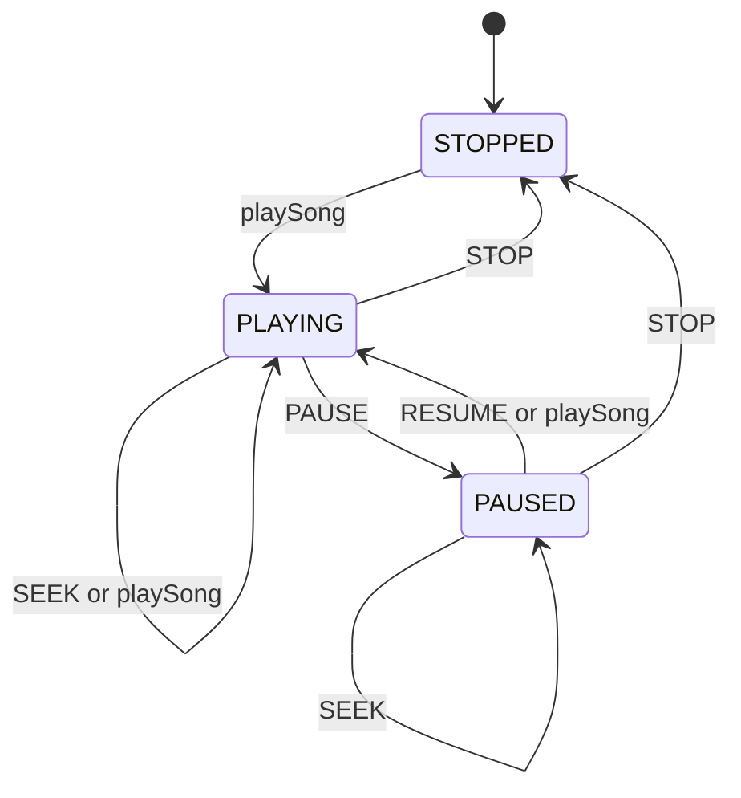

# Design Spotify Music Streaming in Python

#### Problem Statement
[https://codezym.com/question/268-spotify-music-streaming-and-search](https://codezym.com/question/268-spotify-music-streaming-and-search)

This problem has two separate parts. A **music catalogue** stores songs and answers searches. A **playback session** for each user remembers what that user is listening to.

The best fit is a mix of two design patterns. The **State pattern** runs playback, because what `PAUSE`, `RESUME`, `SEEK` and `STOP` do depends only on the current status: playing, paused or stopped. A thin **Facade**, `SpotifyMusicService`, hides the catalogue and the sessions behind one simple class.

The trickiest part is updating a song. Our answer: a session points to the **same `Song` object** that the catalogue holds, so new details show up everywhere for free. Only the duration is copied when the song starts.


## The Rules That Shape the Design

- Updating a song must not reset or recreate any session.
- A user playing an updated song sees the new title, artist and album, but keeps the old duration until the song is started again.
- Search is a case-insensitive substring match on title, artist and album (not on the song id). Results are sorted by `songId`.
- What a control action does depends on the current status.


## A Simple First Attempt

The quickest way is to put everything in one class with a few dictionaries.

```python
# Everything lives inside one class
self.songs = {}         # songId -> [title, artist, album, duration]
self.status = {}        # userId -> PLAYING, PAUSED or STOPPED
self.current_song = {}  # userId -> songId or NO_SONG
self.position = {}      # userId -> seconds
```

Search checks every song, lowercases its fields and then sorts the matches.

```python
def searchSongs(self, query):
    q = query.lower()
    ids = []
    for song_id, (title, artist, album, _) in self.songs.items():
        # lowercase every field again, on every search
        if q in title.lower() or q in artist.lower() or q in album.lower():
            ids.append(song_id)
    ids.sort()  # sort the matches on every search
    result = []
    for song_id in ids:
        title, artist, album, duration = self.songs[song_id]
        result.append(f"{song_id},{title},{artist},{album},{duration}")
    return result
```

Playback control is a chain of `if-elif` checks.

```python
def controlPlayback(self, userId, action, positionSeconds):
    current = self.status[userId]
    if action == "PAUSE" and current == "PLAYING":
        self.status[userId] = "PAUSED"
    elif action == "RESUME" and current == "PAUSED":
        self.status[userId] = "PLAYING"
    elif action == "SEEK" and current != "STOPPED":
        self.position[userId] = positionSeconds
    elif action == "STOP":
        # every dict must be reset by hand
        self.status[userId] = "STOPPED"
        self.current_song[userId] = "NO_SONG"
        self.position[userId] = 0
    return (f"{self.status[userId]},{self.current_song[userId]},"
            f"{self.position[userId]}")
```

It works, but it has real problems.

- **Search repeats work.** Every search lowercases every field of every song, builds every output line again and sorts the matches.
- **One session is spread over three dictionaries.** `STOP` must reset all of them, and the duration rule would need a fourth one. Missing one is an easy bug.
- **Status rules are tangled.** Each branch mixes "which action came" with "which status we are in". A new status, like `BUFFERING`, means touching many branches.
- **Catalogue and playback live in one class**, but the problem asks for separate components.


## The Better Solution

We fix these problems in four steps.

### Step 1: Split the work into small classes

| Class | Job |
|---|---|
| `Song` | One song and its details |
| `MusicCatalogue` | Stores all songs and runs search |
| `PlaybackSession` | One user's song, position and status |
| `PlaybackState` and its 3 states | What each action does in each status |
| `SpotifyMusicService` | The Facade the caller talks to |

`SpotifyMusicService` keeps a dictionary from user id to `PlaybackSession`, with one session per user. Each session is its own object, so one user's playback can never change another user's.

The service only forwards each call to the right part. That is the Facade's whole job here.

### Step 2: Share the song, copy the duration

This one idea handles all the update rules.

`addOrUpdateSong` never replaces an existing `Song`. It **changes the same object in place**. A session keeps a reference to that same object, so a playing user sees the new title, artist and album right away. No extra code is needed.

The duration is different. It must stay fixed for the current session, so the session **copies** it when the song starts.

```python
def play(self, song):
    """Works the same from every state: the new song starts from 0."""
    # Shared object: the user sees later title, artist and album updates
    self.song = song
    # Own copy: the duration never changes for this session
    self.duration_seconds = song.duration_seconds
    self.position_seconds = 0
    self.state = PlayingState()
```

Playing a song again makes a fresh copy. So a restart uses the new catalogue duration, just as the problem asks.

### Step 3: Make search cheaper

A query can match the middle of a word, like `oad` inside `Road`. A word index can't find that, so we still check every song. But we make each check cheap.

- **Prepare once, reuse many times.** `Song` builds its lowercase fields and its output line once, inside `update()`. A search only runs `in` checks and adds ready-made strings.
- **Keep the songs sorted all the time.** `MusicCatalogue` combines a dictionary (fast lookup by id) with a list sorted by `song_id`. A new song goes to the index found by a binary search. Updates never change an id, so the list stays sorted. Search walks the list in order, so the matches come out already sorted.

### Step 4: The State pattern for playback

Here is the state machine behind the control rules.



| Action | `StoppedState` | `PlayingState` | `PausedState` |
|---|---|---|---|
| `PAUSE` | no change | becomes paused | no change |
| `RESUME` | no change | no change | becomes playing |
| `SEEK` | no change | moves position | moves position |
| `STOP` | no change | clears session | clears session |

Each column of this table becomes one small class.

- `PlaybackState` is a base class whose action methods do nothing.
- Each state overrides only the actions it allows. `StoppedState` allows none, so it only returns its status name.
- `PlaybackSession` keeps the current state and hands every action to it.
- `playSong` works the same in every status, so it lives directly in `PlaybackSession`.

The problem promises that every action comes in a valid status. The "no change" defaults just keep the code safe, with no extra checks.

**Why not an `Enum` and a single `if-elif` chain?** With three statuses it would work. But all the rules would sit in one method that grows with every new status or action. With the State pattern, the rules of one status live in one small class. A new status like `BUFFERING` is just one new class.


## Patterns That Look Good but Don't Fit

**Observer.** "Users playing an updated song see its new details" sounds like the catalogue should notify every listening session. But each session already holds the same `Song` object, so it sees changes instantly. Observer would add subscribe and unsubscribe work on every play and stop, plus extra care to keep the copied duration untouched.

**Command.** We could wrap `PAUSE`, `RESUME`, `SEEK` and `STOP` in command objects. Commands shine when you need undo, a queue or a history of actions. Here each action runs once, right away, and its meaning depends on the status, which the State pattern already handles. Commands would only add classes.


## Complexity

`N` is the number of songs and `L` is the length of a text field (at most 100).

| Method | Time |
|---|---|
| `addOrUpdateSong` | O(L) for an update. A new song also needs O(log N) to find its index, plus a list shift that is O(N) in the worst case |
| `searchSongs` | O(N × L), one pass over the sorted list, no sorting |
| `playSong` | O(1) |
| `controlPlayback` | O(1) |


## Final Code

```python
class Song:
    """One song in the catalogue.

    The same object is shared with every playback session that plays it,
    so updating it in place makes the new details visible everywhere.
    """

    def __init__(self, song_id, title, artist, album, duration_seconds):
        self.song_id = song_id
        self.update(title, artist, album, duration_seconds)

    def update(self, title, artist, album, duration_seconds):
        self.title = title
        self.artist = artist
        self.album = album
        self.duration_seconds = duration_seconds
        # Built once per update, so every search can reuse them
        self.title_lower = title.lower()
        self.artist_lower = artist.lower()
        self.album_lower = album.lower()
        self.formatted = (f"{self.song_id},{title},{artist},"
                          f"{album},{duration_seconds}")

    def matches(self, lower_query):
        """lower_query must already be in lowercase."""
        return (lower_query in self.title_lower
                or lower_query in self.artist_lower
                or lower_query in self.album_lower)


class MusicCatalogue:
    """Stores every song and answers search queries."""

    def __init__(self):
        # song_id -> song, for quick lookup when adding, updating or playing
        self.songs_by_id = {}
        # All songs, always sorted by song_id, so results come out in order
        self.songs_in_id_order = []

    def add_or_update_song(self, song_id, title, artist, album,
                           duration_seconds):
        song = self.songs_by_id.get(song_id)
        if song is not None:
            # Change the same object, never replace it,
            # so users playing this song see the update
            song.update(title, artist, album, duration_seconds)
            return
        song = Song(song_id, title, artist, album, duration_seconds)
        self.songs_by_id[song_id] = song
        index = self.find_insert_position(song_id)
        self.songs_in_id_order.insert(index, song)

    def find_insert_position(self, song_id):
        """Binary search: index where song_id goes to keep the list sorted."""
        low, high = 0, len(self.songs_in_id_order)
        while low < high:
            mid = (low + high) // 2
            if self.songs_in_id_order[mid].song_id < song_id:
                low = mid + 1
            else:
                high = mid
        return low

    def get_song(self, song_id):
        return self.songs_by_id[song_id]

    def search(self, query):
        lower_query = query.lower()
        return [song.formatted for song in self.songs_in_id_order
                if song.matches(lower_query)]


class PlaybackState:
    """State pattern: each status decides what PAUSE, RESUME, SEEK and STOP do.

    By default an action changes nothing.
    Each state overrides only the actions it allows.
    """

    def get_status(self):
        raise NotImplementedError

    def pause(self, session):
        pass

    def resume(self, session):
        pass

    def seek(self, session, position_seconds):
        pass

    def stop(self, session):
        pass


class PlayingState(PlaybackState):
    def get_status(self):
        return "PLAYING"

    def pause(self, session):
        session.state = PausedState()

    def seek(self, session, position_seconds):
        session.position_seconds = position_seconds  # status stays PLAYING

    def stop(self, session):
        session.clear()


class PausedState(PlaybackState):
    def get_status(self):
        return "PAUSED"

    def resume(self, session):
        session.state = PlayingState()

    def seek(self, session, position_seconds):
        session.position_seconds = position_seconds  # status stays PAUSED

    def stop(self, session):
        session.clear()


class StoppedState(PlaybackState):
    """No song is selected, so every control action keeps it empty."""

    def get_status(self):
        return "STOPPED"


class PlaybackSession:
    """Playback session of one user.

    Every control action is handed to the current state object.
    """

    def __init__(self):
        self.state = StoppedState()
        self.song = None  # None when no song is selected
        self.duration_seconds = 0
        self.position_seconds = 0

    def play(self, song):
        """Works the same from every state: the new song starts from 0."""
        # Shared object: the user sees later title, artist and album updates
        self.song = song
        # Own copy: the duration never changes for this session
        self.duration_seconds = song.duration_seconds
        self.position_seconds = 0
        self.state = PlayingState()

    def pause(self):
        self.state.pause(self)

    def resume(self):
        self.state.resume(self)

    def seek(self, position_seconds):
        self.state.seek(self, position_seconds)

    def stop(self):
        self.state.stop(self)

    def clear(self):
        """STOP forgets the song and leaves an empty session."""
        self.song = None
        self.duration_seconds = 0
        self.position_seconds = 0
        self.state = StoppedState()

    def format(self):
        """Format: "status,songId,positionSeconds"."""
        song_id = "NO_SONG" if self.song is None else self.song.song_id
        return f"{self.state.get_status()},{song_id},{self.position_seconds}"


class SpotifyMusicService:
    """Facade: the only class the caller talks to.

    It owns the catalogue and one playback session per user,
    and forwards each call.
    """

    def __init__(self, userIds):
        self.catalogue = MusicCatalogue()
        # user_id -> that user's own playback session
        self.sessions = {user_id: PlaybackSession() for user_id in userIds}

    def addOrUpdateSong(self, songId, title, artist, album, durationSeconds):
        self.catalogue.add_or_update_song(songId, title, artist, album,
                                          durationSeconds)

    def searchSongs(self, query):
        return self.catalogue.search(query)

    def playSong(self, userId, songId):
        session = self.sessions[userId]
        session.play(self.catalogue.get_song(songId))
        return session.format()

    def controlPlayback(self, userId, action, positionSeconds):
        session = self.sessions[userId]
        if action == "PAUSE":
            session.pause()
        elif action == "RESUME":
            session.resume()
        elif action == "SEEK":
            session.seek(positionSeconds)
        elif action == "STOP":
            session.stop()
        return session.format()
```