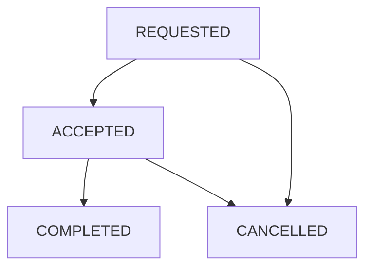

# Design Cab Booking Service in Java

#### Problem Statement

[https://codezym.com/question/269-cab-booking-service](https://codezym.com/question/269-cab-booking-service)


Keep each booking in a `Ride` object and find it directly using its supplied ride ID. A small `FarePolicy` class holds the rates and calculates the fare, while the service updates rides and participant availability. Both ride types share one formula, so ordinary classes, maps and a set are enough. No formal design pattern is needed for these fixed rules.


## Start with a list

We could keep rides in a list. To accept, complete or cancel a ride, scan that list for the matching ID.

```java
// In this basic version, rides is a List<Ride>.
Ride findRide(String rideId) {
    for (Ride ride : rides) {
        if (ride.rideId.equals(rideId)) {
            return ride;
        }
    }
    return null;
}
```

With `R` stored rides, one lookup can take `O(R)` time. A `HashMap` from ride ID to `Ride` reduces this to expected `O(1)` time. The remaining work is a few field and collection updates.


## Choose a small design

`Ride` stores the booking details, status, assigned driver and calculated fare. Its `format()` method produces the required output in one place, so every operation uses the same field order.


`FarePolicy` stores the base fare, distance rate and time rate. Two objects represent `STANDARD` and `PREMIUM`, and both use the same calculation method.


`CabBookingService` keeps three collections for booking state.

- `rides` maps every supplied ride ID to its booking. Finished rides stay here as history.
- `activeRideByPassenger` maps each registered passenger to their active ride ID. A `null` value means they have no active ride.
- `availableDrivers` contains all registered drivers initially. Acceptance removes a driver, and completion or cancellation makes an assigned driver available again.

The separate `farePolicies` map selects the rate object by ride type. All IDs come from the input.


The statement guarantees valid IDs, ownership, ride status and driver availability for every call. We maintain the booking state without adding validation or error responses that the problem does not define.


### Would Strategy or State help?

Strategy would help if ride types used different pricing algorithms. Here only three numbers change, so two instances of `FarePolicy` are simpler than separate strategy classes.


State would help if each ride status had substantial behaviour of its own. Here the allowed calls make a few direct updates, so separate state classes would add little value.


## Calculate the fare once

For `STANDARD`, use `40.0 + distanceKm * 12.0 + rideTimeMinutes * 2.0`.


For `PREMIUM`, use `80.0 + distanceKm * 20.0 + rideTimeMinutes * 3.0`.


Evaluate the complete expression, then truncate the result. For a standard ride of `5.27` km and `15` minutes, the total is `133.24`, so the stored fare is `133`. Casting to `int` removes the fractional part. Do not round to the nearest integer.


The fare is saved when the ride is requested. Later operations keep it unchanged.


## Update the ride and its participants together



Requesting a ride makes the passenger busy. Acceptance assigns the supplied driver. On completion or cancellation, `releaseParticipants()` clears the passenger's active ride and releases the driver if one was assigned.


Releasing a driver does not remove their ID from the historical ride. Cancelling before acceptance leaves the driver unassigned.


Internally, an unassigned driver is `null`. Only the output converts that value to `"none"`. This also works if a real driver's supplied ID is literally `"none"`.


The returned string always follows this order.

```text
rideId,status,passengerId,driverId,pickupLocation,destination,rideType,fare
```


## Time and space

Initialization takes `O(P + D)` time for `P` passengers and `D` drivers. Each operation performs expected `O(1)` map and set work, plus `O(L)` time to build an output string of length `L`. Stored state takes `O(P + D + R)` space for `R` requested rides, treating the bounded field lengths as constant.


## Complete solution

Save the code as `CabBookingService.java`.

```java
import java.util.HashMap;
import java.util.HashSet;
import java.util.List;
import java.util.Map;
import java.util.Set;

public class CabBookingService {
    Map<String, Ride> rides = new HashMap<>();
    Map<String, String> activeRideByPassenger = new HashMap<>();
    Set<String> availableDrivers;
    Map<String, FarePolicy> farePolicies = new HashMap<>();

    public CabBookingService(List<String> passengerIds, List<String> driverIds) {
        for (String passengerId : passengerIds) {
            // A null value means this passenger has no active ride.
            activeRideByPassenger.put(passengerId, null);
        }
        availableDrivers = new HashSet<>(driverIds);
        farePolicies.put("STANDARD", new FarePolicy(40.0, 12.0, 2.0));
        farePolicies.put("PREMIUM", new FarePolicy(80.0, 20.0, 3.0));
    }

    public String requestRide(
            String rideId,
            String passengerId,
            String pickupLocation,
            String destination,
            double distanceKm,
            String rideType,
            int rideTimeMinutes
    ) {
        FarePolicy policy = farePolicies.get(rideType);
        int fare = policy.calculateFare(distanceKm, rideTimeMinutes);
        Ride ride = new Ride(
                rideId, passengerId, pickupLocation, destination,
                distanceKm, rideType, rideTimeMinutes, fare
        );

        // Inputs already satisfy the problem's validity conditions.
        rides.put(rideId, ride);
        activeRideByPassenger.put(passengerId, rideId);
        return ride.format();
    }

    public String acceptRide(String driverId, String rideId) {
        Ride ride = rides.get(rideId);
        ride.driverId = driverId;
        ride.status = "ACCEPTED";
        availableDrivers.remove(driverId);
        return ride.format();
    }

    public String completeRide(String driverId, String rideId) {
        Ride ride = rides.get(rideId);
        ride.status = "COMPLETED";
        releaseParticipants(ride);
        return ride.format();
    }

    public String cancelRide(String passengerId, String rideId) {
        Ride ride = rides.get(rideId);
        ride.status = "CANCELLED";
        releaseParticipants(ride);
        return ride.format();
    }

    void releaseParticipants(Ride ride) {
        activeRideByPassenger.put(ride.passengerId, null);
        if (ride.driverId != null) {
            availableDrivers.add(ride.driverId);
        }
        // Keep the assigned driver ID in the finished ride's history.
    }
}

class FarePolicy {
    double baseFare;
    double distanceRate;
    double timeRate;

    FarePolicy(double baseFare, double distanceRate, double timeRate) {
        this.baseFare = baseFare;
        this.distanceRate = distanceRate;
        this.timeRate = timeRate;
    }

    int calculateFare(double distanceKm, int rideTimeMinutes) {
        double total = baseFare
                + distanceKm * distanceRate
                + rideTimeMinutes * timeRate;
        // Truncate only after evaluating the complete expression.
        return (int) total;
    }
}

class Ride {
    String rideId;
    String passengerId;
    String pickupLocation;
    String destination;
    double distanceKm;
    String rideType;
    int rideTimeMinutes;
    int fare;
    String status = "REQUESTED";
    String driverId = null;

    Ride(
            String rideId,
            String passengerId,
            String pickupLocation,
            String destination,
            double distanceKm,
            String rideType,
            int rideTimeMinutes,
            int fare
    ) {
        this.rideId = rideId;
        this.passengerId = passengerId;
        this.pickupLocation = pickupLocation;
        this.destination = destination;
        this.distanceKm = distanceKm;
        this.rideType = rideType;
        this.rideTimeMinutes = rideTimeMinutes;
        this.fare = fare;
    }

    String format() {
        String driverText = driverId == null ? "none" : driverId;
        return rideId + "," + status + "," + passengerId + "," + driverText
                + "," + pickupLocation + "," + destination
                + "," + rideType + "," + fare;
    }
}
```
