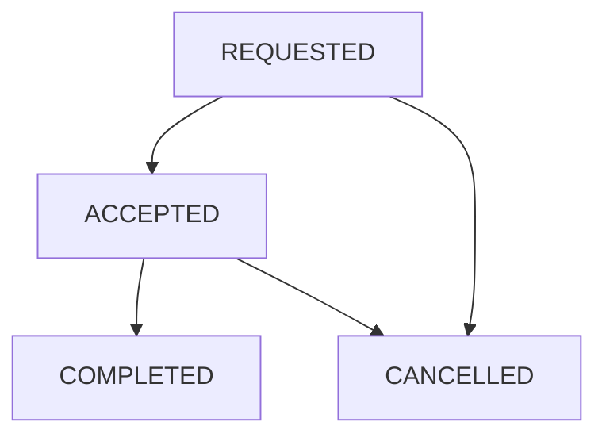

# Design Cab Booking Service in Python

#### Problem Statement

[https://codezym.com/question/269-cab-booking-service](https://codezym.com/question/269-cab-booking-service)


Keep each booking in a `Ride` object and find it directly using its supplied ride ID. A small `FarePolicy` class holds the rates and calculates the fare, while the service updates rides and participant availability. Both ride types share one formula, so ordinary classes, maps and a set are enough. No formal design pattern is needed for these fixed rules.


## Start with a list

We could keep rides in a list. To accept, complete or cancel a ride, scan that list for the matching ID.

```python
# In this basic version, self.rides is a list of Ride objects.
def findRide(self, rideId):
    for ride in self.rides:
        if ride.rideId == rideId:
            return ride
    return None
```

With `R` stored rides, one lookup can take `O(R)` time. A dictionary from ride ID to `Ride` reduces this to expected `O(1)` time. The remaining work is a few field and collection updates.


## Choose a small design

`Ride` stores the booking details, status, assigned driver and calculated fare. Its `format()` method produces the required output in one place, so every operation uses the same field order.


`FarePolicy` stores the base fare, distance rate and time rate. Two objects represent `STANDARD` and `PREMIUM`, and both use the same calculation method.


`CabBookingService` keeps three collections for booking state.

- `rides` maps every supplied ride ID to its booking. Finished rides stay here as history.
- `activeRideByPassenger` maps each registered passenger to their active ride ID. A `None` value means they have no active ride.
- `availableDrivers` contains all registered drivers initially. Acceptance removes a driver, and completion or cancellation makes an assigned driver available again.

The separate `farePolicies` map selects the rate object by ride type. All IDs come from the input.


The statement guarantees valid IDs, ownership, ride status and driver availability for every call. We maintain the booking state without adding validation or error responses that the problem does not define.


### Would Strategy or State help?

Strategy would help if ride types used different pricing algorithms. Here only three numbers change, so two instances of `FarePolicy` are simpler than separate strategy classes.


State would help if each ride status had substantial behaviour of its own. Here the allowed calls make a few direct updates, so separate state classes would add little value.


## Calculate the fare once

For `STANDARD`, use `40.0 + distanceKm * 12.0 + rideTimeMinutes * 2.0`.


For `PREMIUM`, use `80.0 + distanceKm * 20.0 + rideTimeMinutes * 3.0`.


Evaluate the complete expression, then truncate the result. For a standard ride of `5.27` km and `15` minutes, the total is `133.24`, so the stored fare is `133`. `int(total)` removes the fractional part. Do not round to the nearest integer.


The fare is saved when the ride is requested. Later operations keep it unchanged.


## Update the ride and its participants together



Requesting a ride makes the passenger busy. Acceptance assigns the supplied driver. On completion or cancellation, `releaseParticipants()` clears the passenger's active ride and releases the driver if one was assigned.


Releasing a driver does not remove their ID from the historical ride. Cancelling before acceptance leaves the driver unassigned.


Internally, an unassigned driver is `None`. Only the output converts that value to `"none"`. This also works if a real driver's supplied ID is literally `"none"`.


The returned string always follows this order.

```text
rideId,status,passengerId,driverId,pickupLocation,destination,rideType,fare
```


## Time and space

Initialization takes `O(P + D)` time for `P` passengers and `D` drivers. Each operation performs expected `O(1)` map and set work, plus `O(L)` time to build an output string of length `L`. Stored state takes `O(P + D + R)` space for `R` requested rides, treating the bounded field lengths as constant.


## Complete solution

The public method names and argument order match the supplied starter code. Dataclasses keep the two data objects concise.

```python
from dataclasses import dataclass
from typing import Dict, List, Optional, Set


@dataclass
class FarePolicy:
    baseFare: float
    distanceRate: float
    timeRate: float

    def calculateFare(self, distanceKm: float, rideTimeMinutes: int) -> int:
        total = (
            self.baseFare
            + distanceKm * self.distanceRate
            + rideTimeMinutes * self.timeRate
        )
        # Truncate only after evaluating the complete expression.
        return int(total)


@dataclass
class Ride:
    rideId: str
    passengerId: str
    pickupLocation: str
    destination: str
    distanceKm: float
    rideType: str
    rideTimeMinutes: int
    fare: int
    status: str = "REQUESTED"
    driverId: Optional[str] = None

    def format(self) -> str:
        driverText = "none" if self.driverId is None else self.driverId
        return (
            f"{self.rideId},{self.status},{self.passengerId},{driverText},"
            f"{self.pickupLocation},{self.destination},{self.rideType},{self.fare}"
        )


class CabBookingService:
    def __init__(self, passengerIds: List[str], driverIds: List[str]):
        self.rides: Dict[str, Ride] = {}
        # A None value means this passenger has no active ride.
        self.activeRideByPassenger: Dict[str, Optional[str]] = {
            passengerId: None for passengerId in passengerIds
        }
        self.availableDrivers: Set[str] = set(driverIds)
        self.farePolicies: Dict[str, FarePolicy] = {
            "STANDARD": FarePolicy(40.0, 12.0, 2.0),
            "PREMIUM": FarePolicy(80.0, 20.0, 3.0),
        }

    def requestRide(
        self,
        rideId: str,
        passengerId: str,
        pickupLocation: str,
        destination: str,
        distanceKm: float,
        rideType: str,
        rideTimeMinutes: int,
    ) -> str:
        policy = self.farePolicies[rideType]
        fare = policy.calculateFare(distanceKm, rideTimeMinutes)
        ride = Ride(
            rideId, passengerId, pickupLocation, destination,
            distanceKm, rideType, rideTimeMinutes, fare,
        )

        # Inputs already satisfy the problem's validity conditions.
        self.rides[rideId] = ride
        self.activeRideByPassenger[passengerId] = rideId
        return ride.format()

    def acceptRide(self, driverId: str, rideId: str) -> str:
        ride = self.rides[rideId]
        ride.driverId = driverId
        ride.status = "ACCEPTED"
        self.availableDrivers.remove(driverId)
        return ride.format()

    def completeRide(self, driverId: str, rideId: str) -> str:
        ride = self.rides[rideId]
        ride.status = "COMPLETED"
        self.releaseParticipants(ride)
        return ride.format()

    def cancelRide(self, passengerId: str, rideId: str) -> str:
        ride = self.rides[rideId]
        ride.status = "CANCELLED"
        self.releaseParticipants(ride)
        return ride.format()

    def releaseParticipants(self, ride: Ride) -> None:
        self.activeRideByPassenger[ride.passengerId] = None
        if ride.driverId is not None:
            self.availableDrivers.add(ride.driverId)
        # Keep the assigned driver ID in the finished ride's history.
```
