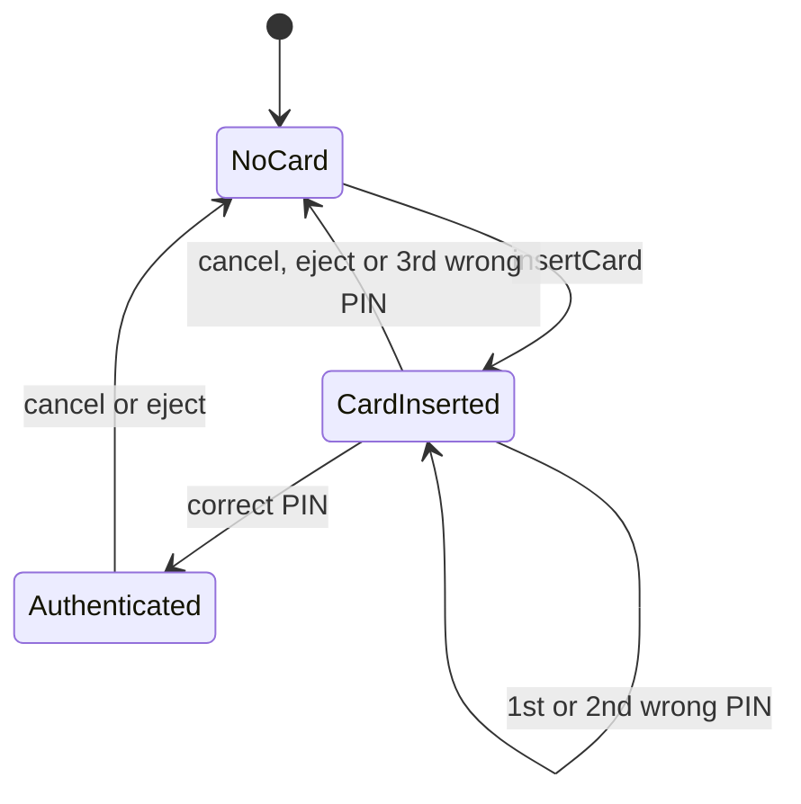

# Design an ATM System in Java

#### Problem Statement
[https://codezym.com/question/296-design-atm-system](https://codezym.com/question/296-design-atm-system)

An ATM is always in one of three situations: **no card**, **card inserted** (PIN not checked yet) or **authenticated**. Almost every rule in this problem says which action is allowed in which situation.

So the core idea is the **State pattern**. We write one small class for each situation, and the ATM simply passes every customer call to its current state. A call made in the wrong order fails on its own, because that state does not allow it.

The other tricky part is picking notes for a withdrawal. Taking the biggest notes first (greedy) can fail even when an answer exists. We replace it with a tiny search that checks only 4 note combinations and is always correct.

The State pattern alone is the right fit here. A combination of patterns is not needed. Accounts and cash are kept in simple hash maps.

## Understanding the Problem

The problem has three parts:

1. **Accounts.** Each card has a PIN, a balance, a count of wrong PIN attempts and a blocked flag.
2. **Cash in the ATM.** How many 2000, 500, 200 and 100 notes it holds.
3. **The session.** Insert card → enter PIN → check balance, withdraw or deposit → eject.

A few rules need extra care:

- Wrong PIN attempts are remembered across sessions. Three in a row block the card forever and eject it.
- A failed withdrawal or deposit must change nothing.
- A withdrawal must use the fewest notes possible.

## A Simple First Attempt

The most direct design keeps two flags and checks them at the top of every method. For withdrawals, it takes the biggest notes first.

```java
boolean cardInserted = false;
boolean authenticated = false;

public int getBalance() {
    if (!cardInserted || !authenticated) return -1;
    return activeAccount.balance;
}

public List<Integer> withdrawCash(int amount) {
    if (!cardInserted || !authenticated) return List.of(-1);

    // Greedy: take as many big notes as possible first
    int left = amount;
    for (int note : new int[]{2000, 500, 200, 100}) {
        int take = Math.min(noteCount.get(note), left / note);
        left -= take * note;
        // ... remember 'take' notes of this value
    }
    if (left != 0) return List.of(-1); // greedy got stuck

    // ... update the balance and the notes
}
```

It works for easy cases, but it has two problems.

**Problem 1: Greedy picks the wrong notes.** In Example 1, we withdraw 600 and the ATM has one 500 note and three 200 notes. Greedy takes the 500 note first. Now it needs 100 more, and there is no 100 note. So it fails, even though 200 + 200 + 200 works.

**Problem 2: Flag checks are everywhere.** Every method repeats the same kind of check, each one slightly different. For example, `enterPin` must fail when the PIN is already accepted, while `getBalance` must fail when it is not. One missed check is a bug. Adding a new situation later (like "out of service") means editing every method.

Let us fix these one at a time.

## Fix 1: Picking the Right Notes

### Brute force

Try every count of 2000, 500 and 200 notes. The count of 100 notes is then fixed by the amount. Keep the combination with the fewest notes.

This is always correct, but far too slow. For 1,000,000 it is about 500 × 2,000 × 5,000 combinations, for a single withdrawal.

### Step 1: Fill the bottom with a simple rule

Suppose the 2000 and 500 notes are already chosen. The leftover is paid with 200 and 100 notes.

One 200 note replaces two 100 notes. So the fewest notes come from **as many 200 notes as possible, then 100 notes** for the rest. If there are not enough 100 notes, this choice fails, because fewer 200 notes would need even more 100 notes.

Now we only loop over the 2000 and 500 counts. That is still up to 500 × 2,000 = 1,000,000 tries per withdrawal. Too slow for 100,000 calls.

### Step 2: Only two counts of 500 notes matter

200 notes alone can only make "even hundreds" like 200, 400 or 800. "Odd hundreds" like 300 or 900 also need a 100 note.

Using one fewer 500 note switches the leftover between odd and even hundreds. Say the leftover is 300, and the ATM has no 100 notes but has enough 200 notes. That fails. With one fewer 500 note, the leftover becomes 800, and four 200 notes can pay it.

Going further down never helps. Two fewer 500 notes gives the same odd or even leftover as the maximum, three fewer gives the same as one less, and so on. Each time the leftover is just 1,000 bigger, which is never easier to pay and always needs more notes.

So for 500 notes we only try **the maximum count and one less**.

### Step 3: Only two counts of 2000 notes matter

Sometimes one fewer 2000 note is needed. Say we withdraw 2,100. The ATM has one 2000 note, three 500 notes, three 200 notes and no 100 notes. With the 2000 note we still need 100, which is impossible. Without it, 500 + 500 + 500 + 200 + 200 + 200 works.

But using two or more fewer 2000 notes than the maximum is never needed. The smaller notes would then pay at least 4,000. A pile of smaller notes worth that much always has a part worth exactly 2,000:

- If it has four or more 500 notes, four of them make 2,000.
- Otherwise its 500 notes are worth at most 1,500, so its 200 and 100 notes are worth at least 2,500. Taking up to ten 200 notes, then 100 notes, always makes exactly 2,000.

Swap that part (at least 4 notes) for one of the unused 2000 notes, and the answer has fewer notes. So it was never the best.

So for 2000 notes we also only try **the maximum count and one less**.

### The final rule

We check 2 counts of 2000 notes × 2 counts of 500 notes = **4 combinations**. Each one is filled with as many 200 notes as possible, then 100 notes. We keep the one with the fewest notes.

Ties need no extra code. We try bigger counts first and only replace the answer when we find **strictly fewer** notes. So on a tie, the earlier choice wins, and it has more 2000 notes, then more 500 notes.

Here is the first withdrawal of Example 1 (600, with one 500 note and three 200 notes):

| 2000 notes | 500 notes | Leftover | 200 notes | 100 notes needed | Result |
|---|---|---|---|---|---|
| 0 | 1 | 100 | 0 | 1 (have 0) | fails |
| 0 | 0 | 600 | 3 | 0 | 3 notes, best |

The answer is `[200, 200, 200]`.

## Fix 2: The State Pattern for the Session

Look at the "Method Call Order" rules. Each one says an action only works in a certain situation. That is exactly what the **State pattern** is made for.



| Action | No card | Card inserted | Authenticated |
|---|---|---|---|
| `insertCard` | starts a session | fails | fails |
| `enterPin` | fails | checks the PIN | fails |
| `getBalance`, `withdrawCash`, `depositCash` | fail | fail | work |
| `cancelSession`, `ejectCard` | fail | end the session | end the session |

How it works:

- `ATMState` is a base class where every action fails by default. It returns `false`, `-1` or `[-1]`.
- Each state overrides only the actions it allows.
- `ATMSystem` keeps the current state and passes every customer call to it.
- States move the ATM along. A correct PIN moves it to `AuthenticatedState`. Cancel, eject or a third wrong PIN move it back to `NoCardState`.

Why this is better than flags:

- All the rules of one situation live in one small class.
- Wrong-order calls are rejected by the base class, so no check can be forgotten.
- A new situation (like "out of service") is just one new class.

`cancelSession` and `ejectCard` behave exactly the same in this problem, so both call the same state method, `ejectCard`.

## Patterns That Look Good but Don't Fit

**Chain of Responsibility.** Many ATM designs pass the amount through a chain of dispensers: 2000 → 500 → 200 → 100. Each one takes as many notes as it can and passes the rest on. That is the greedy idea again, so it fails Example 1. Our rule needs to compare whole combinations, which a chain of handlers can't do.

**Strategy.** We could put note picking behind a `DispenseStrategy` interface. But there is only one rule, and it never changes at runtime. A plain method in `CashVault` is simpler. If a second rule ever shows up, it is easy to turn it into a strategy then.

## Class Design

```
ATMSystem
 ├── accounts       Map<String, Account>   card number → account
 ├── vault          CashVault              note value → count
 ├── activeAccount  Account                card inside the ATM, or null
 └── currentState   ATMState
                     ├── NoCardState
                     ├── CardInsertedState
                     └── AuthenticatedState
```

**`Account`** holds the card number, PIN, balance, failed attempts and the blocked flag. Failed attempts must survive across sessions, so they belong to the account and not to the session.

**`CashVault`** holds a `Map<Integer, Long>` from note value to count. A map makes lookups simple, and `containsKey` also tells us if a note is supported. Counts are `long` because many `loadCash` calls can add up past the `int` limit. It also finds and removes notes for a withdrawal.

**`ATMState` and its 3 states** hold the session rules shown above.

**`ATMSystem`** holds a `Map<String, Account>` for quick lookup by card number. Java strings are case-sensitive, so `insertCard("card1")` does not find the account `"CARD1"`, as the problem requires. Admin methods (`addAccount`, `loadCash`) are handled here directly, because they are allowed at any time. `addAccount` checks the card number (1 to 20 uppercase letters or digits) and the PIN (exactly 4 digits) with short regular expressions.

**All or nothing.** `withdrawCash` and `depositCash` first check everything. Only when every check passes do they change the balance and the vault. A failed call returns before touching anything, so there are never partial changes.

## Complexity

- **Withdraw:** only 4 combinations are checked, so picking notes takes constant time. Building the result list takes time equal to the number of notes given out.
- **Deposit:** linear in the number of notes deposited.
- **Everything else:** constant time, using map lookups.

## Java Code

```java
import java.util.*;

/**
 * A bank account linked to one card.
 * Failed PIN attempts are stored here and not in the session,
 * so they are remembered across sessions.
 */
class Account {
    String cardNumber;
    String pin;
    int balance;
    int failedAttempts = 0;
    boolean blocked = false;

    Account(String cardNumber, String pin, int balance) {
        this.cardNumber = cardNumber;
        this.pin = pin;
        this.balance = balance;
    }
}

/**
 * Keeps the notes that are inside the ATM and picks notes for a withdrawal.
 */
class CashVault {
    // note value -> number of such notes inside the ATM.
    // long, because many loadCash() calls can add up to more than an int can hold.
    Map<Integer, Long> noteCount = new HashMap<>();

    CashVault() {
        noteCount.put(2000, 0L);
        noteCount.put(500, 0L);
        noteCount.put(200, 0L);
        noteCount.put(100, 0L);
    }

    boolean isSupported(int note) {
        return noteCount.containsKey(note);
    }

    void addNotes(int note, long count) {
        noteCount.put(note, noteCount.get(note) + count);
    }

    void removeNotes(List<Integer> notes) {
        for (int note : notes) {
            noteCount.put(note, noteCount.get(note) - 1);
        }
    }

    /**
     * Picks notes that add up to exactly amount, using the fewest notes.
     * On a tie, it keeps the choice with more 2000 notes, then more 500 notes.
     * Returns the notes in descending order, or null if it is not possible.
     * It does not change the vault.
     */
    List<Integer> findNotes(int amount) {
        long have2000 = noteCount.get(2000);
        long have500 = noteCount.get(500);
        long have200 = noteCount.get(200);
        long have100 = noteCount.get(100);

        int[] best = null; // {count of 2000, 500, 200, 100}
        int bestTotal = Integer.MAX_VALUE;

        // Only the two largest counts of 2000 notes can give the best answer.
        int max2000 = (int) Math.min(have2000, amount / 2000);
        int min2000 = Math.max(0, max2000 - 1);
        for (int n2000 = max2000; n2000 >= min2000; n2000--) {
            int left = amount - n2000 * 2000;

            // Same idea for 500 notes: only the two largest counts are worth trying.
            int max500 = (int) Math.min(have500, left / 500);
            int min500 = Math.max(0, max500 - 1);
            for (int n500 = max500; n500 >= min500; n500--) {
                int rest = left - n500 * 500;

                // Pay the rest with as many 200 notes as possible, then 100 notes.
                int n200 = (int) Math.min(have200, rest / 200);
                int n100 = (rest - n200 * 200) / 100;
                if (n100 > have100) {
                    continue; // not enough 100 notes, so this choice fails
                }

                int total = n2000 + n500 + n200 + n100;
                // Strict '<': on a tie we keep the earlier choice, which has more big notes.
                if (total < bestTotal) {
                    bestTotal = total;
                    best = new int[]{n2000, n500, n200, n100};
                }
            }
        }

        if (best == null) {
            return null;
        }
        int[] values = {2000, 500, 200, 100};
        List<Integer> notes = new ArrayList<>();
        for (int i = 0; i < 4; i++) {
            for (int k = 0; k < best[i]; k++) {
                notes.add(values[i]);
            }
        }
        return notes;
    }
}

/**
 * Base class for all ATM states.
 * Every action is rejected by default.
 * Each state overrides only the actions that are allowed in it.
 */
abstract class ATMState {
    ATMSystem atm;

    ATMState(ATMSystem atm) {
        this.atm = atm;
    }

    boolean insertCard(String cardNumber) {
        return false;
    }

    boolean enterPin(String pin) {
        return false;
    }

    int getBalance() {
        return -1;
    }

    List<Integer> withdrawCash(int amount) {
        return List.of(-1);
    }

    boolean depositCash(List<Integer> notes) {
        return false;
    }

    boolean ejectCard() {
        return false;
    }
}

/**
 * No card inside the ATM. Only inserting a card is allowed.
 */
class NoCardState extends ATMState {

    NoCardState(ATMSystem atm) {
        super(atm);
    }

    @Override
    boolean insertCard(String cardNumber) {
        Account account = atm.accounts.get(cardNumber);
        if (account == null || account.blocked) {
            return false;
        }
        atm.startSession(account);
        return true;
    }
}

/**
 * A card is inside, but the PIN is not verified yet.
 */
class CardInsertedState extends ATMState {

    CardInsertedState(ATMSystem atm) {
        super(atm);
    }

    @Override
    boolean enterPin(String pin) {
        Account account = atm.activeAccount;
        if (account.pin.equals(pin)) {
            account.failedAttempts = 0;
            atm.currentState = atm.authenticatedState;
            return true;
        }

        account.failedAttempts++;
        if (account.failedAttempts >= atm.maxPinAttempts) {
            account.blocked = true; // blocked forever
            atm.endSession();       // and the card is ejected
        }
        return false;
    }

    @Override
    boolean ejectCard() {
        atm.endSession();
        return true;
    }
}

/**
 * The PIN is verified. Balance, withdraw and deposit are allowed.
 */
class AuthenticatedState extends ATMState {

    AuthenticatedState(ATMSystem atm) {
        super(atm);
    }

    @Override
    int getBalance() {
        return atm.activeAccount.balance;
    }

    @Override
    List<Integer> withdrawCash(int amount) {
        Account account = atm.activeAccount;
        if (amount <= 0 || amount % 100 != 0 || amount > account.balance) {
            return List.of(-1);
        }

        List<Integer> notes = atm.vault.findNotes(amount);
        if (notes == null) {
            return List.of(-1);
        }

        // Every check has passed. Now update the vault and the account together.
        atm.vault.removeNotes(notes);
        account.balance -= amount;
        return notes;
    }

    @Override
    boolean depositCash(List<Integer> notes) {
        if (notes == null || notes.isEmpty()) {
            return false;
        }

        // First only check. Nothing is changed until every note is valid.
        int total = 0;
        for (Integer note : notes) {
            if (note == null || !atm.vault.isSupported(note)) {
                return false;
            }
            total += note;
        }

        Account account = atm.activeAccount;
        if (account.balance + total > atm.maxBalance) {
            return false;
        }

        // Every check has passed. Now update the vault and the account together.
        for (int note : notes) {
            atm.vault.addNotes(note, 1);
        }
        account.balance += total;
        return true;
    }

    @Override
    boolean ejectCard() {
        atm.endSession();
        return true;
    }
}

/**
 * The ATM itself. Admin methods are handled here directly.
 * Customer methods are passed to the current state.
 */
public class ATMSystem {
    int maxBalance = 1_000_000;
    int maxPinAttempts = 3;

    // card number -> account
    Map<String, Account> accounts = new HashMap<>();
    CashVault vault = new CashVault();

    // The account whose card is inside the ATM, or null if there is no card.
    Account activeAccount = null;

    // One object for each state. The ATM is always in exactly one of them.
    ATMState noCardState = new NoCardState(this);
    ATMState cardInsertedState = new CardInsertedState(this);
    ATMState authenticatedState = new AuthenticatedState(this);
    ATMState currentState = noCardState;

    public ATMSystem() {
    }

    // ---------------- Admin methods (allowed at any time) ----------------

    public boolean addAccount(String cardNumber, String pin, int openingBalance) {
        // card number: 1 to 20 uppercase letters or digits. PIN: exactly 4 digits.
        if (cardNumber == null || !cardNumber.matches("[A-Z0-9]{1,20}")) {
            return false;
        }
        if (pin == null || !pin.matches("[0-9]{4}")) {
            return false;
        }
        if (openingBalance < 0 || openingBalance > maxBalance) {
            return false;
        }
        if (accounts.containsKey(cardNumber)) {
            return false;
        }
        accounts.put(cardNumber, new Account(cardNumber, pin, openingBalance));
        return true;
    }

    public boolean loadCash(int denomination, int count) {
        if (!vault.isSupported(denomination) || count <= 0) {
            return false;
        }
        vault.addNotes(denomination, count);
        return true;
    }

    // ------------- Customer methods (the current state decides) -------------

    public boolean insertCard(String cardNumber) {
        return currentState.insertCard(cardNumber);
    }

    public boolean enterPin(String pin) {
        return currentState.enterPin(pin);
    }

    public int getBalance() {
        return currentState.getBalance();
    }

    public List<Integer> withdrawCash(int amount) {
        return currentState.withdrawCash(amount);
    }

    public boolean depositCash(List<Integer> notes) {
        return currentState.depositCash(notes);
    }

    // Cancelling the session and ejecting the card do exactly the same thing.
    public boolean cancelSession() {
        return currentState.ejectCard();
    }

    public boolean ejectCard() {
        return currentState.ejectCard();
    }

    // ---------------- Helpers used by the states ----------------

    void startSession(Account account) {
        activeAccount = account;
        currentState = cardInsertedState;
    }

    void endSession() {
        activeAccount = null;
        currentState = noCardState;
    }
}
```